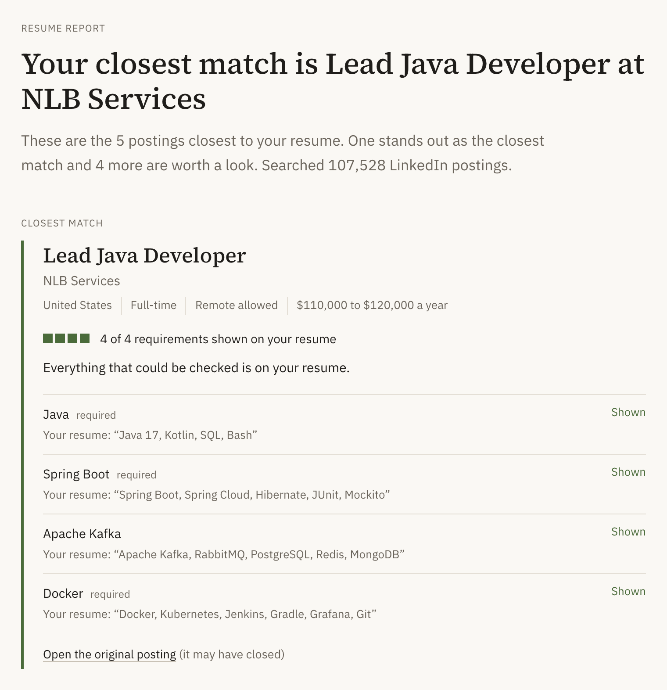

# ResumeMatch

Compares a resume with 107,528 real job postings and shows which requirements it meets, with
every claim checked against the resume and the posting it came from.

[](https://github.com/PubuduGunasekara/rag-resumematch/actions/workflows/ci.yml)
[](LICENSE)

Started in Fall 2026 as an NLP course project at Northeastern (CS6120). This repository is my own portfolio version, designed and built by me.

Instead of scoring one resume against one posting, it searches thousands of postings from a single
resume and checks every claim it shows against the resume and the posting it cites.

Built with Claude Code assistance; the design, experiments and measurements are mine.



## Key results

| Measure | Result | Measured on |
|---|---|---|
| Corpus | 107,528 postings in 237,902 chunks | Full LinkedIn dataset (123,849 rows) after removing 7 empty and 16,314 duplicate postings |
| End-to-end time per resume | 13.8 s median (11.4 to 19.4 s) | M3 Pro laptop, Ollama on the Metal GPU, 3 resumes, 9 runs |
| End-to-end, everything in Docker on CPU | 57 s median (35.5 to 72.3 s) | Docker Desktop on the same Mac (11 CPUs, 8 GB), 3 resumes, 6 runs |
| Where the time goes | About 96% is the model writing its answer; search and fusion take 0.08 to 0.23 s | Same native runs, `scripts/benchmark.py` |
| Tests | 226 passing | No model, index or network needed |
| Typo correction, top-10 overlap with the clean result at 10% typos | 0.68 to 0.82 without correction, 0.92 to 0.98 with | 4 resumes, 5 seeds each; identical across repeated runs |
| Vector search recall against exact search | 0.972 mean recall@30 (0.791 before tuning) | 17 resumes, 91 sections |
| Unsupported claims from the model, before the checks | 35 of 48 "matched" claims (73%) cited a posting that didn't mention them | 6 runs, one resume, `llama3.2:3b`; counted with the same lexical checker the app runs on every claim |
| Chunks containing legal boilerplate | 26.9% before cleanup, 2.9% after | Full index |

Every number above has a source in [docs/design.md](docs/design.md#numbers-and-their-sources).

## The idea in one minute

A 3B language model running on a laptop is fast, free and private, but it misquotes resumes,
cites the wrong posting and lists employee benefits as skills. So the model only proposes. For
each requirement it claims, code checks that the cited posting asks for it, that the resume
quote really is in the resume, and that a "missing" skill isn't actually listed. Only claims
that pass are shown, and the rest are listed with the reason they failed. Rankings and verdicts
are computed in code, never asked of the model.


**What has been audited.** `scripts/audit_grounding.py` runs the full pipeline and re-applies the
app's own checking functions to everything it shows. Over 4 resumes and 2 runs each, 0 of 91 shown
claims failed a check, and 26 of the model's 184 claims were dropped because no retrieved posting
mentioned them. Because the audit reuses the app's checks, this shows that the pipeline enforces its
rules on real output. It does not show that the output is correct: that needs hand-labelled claims,
which don't exist yet ([grounding-audit](docs/engineering-log.md#grounding-audit)).

## How it works


The postings are indexed once. Each upload then goes through ten steps. Details, parameters and
the reasoning for each are in [docs/design.md](docs/design.md).

1. **Upload** a PDF or Word file (5 MB limit, one analysis at a time).
2. **Validate** that it is a real, readable resume before any model runs. A non-resume gets a
   warning the user can override.
3. **Fix typos** by edit distance against a 159,808-word vocabulary from the postings, for the
   search only.
4. **Split into sections** of at most 480 tokens, because the embedding model ignores text past
   512 tokens.
5. **Search** each section (`bge-small-en-v1.5`, ChromaDB) and combine the rankings per posting
   with reciprocal rank fusion. Keep the top 5, at most 2 per company.
6. **Keep the requirement sentences** of each posting, dropping benefits and company blurbs.
7. **Ask the local model** (`llama3.2:3b` through Ollama) once, with a JSON schema enforced.
8. **Check every claim** in code, as in the diagram above.
9. **Build a report per posting:** shown, partly shown or not found for each requirement, the
   closest match, and what to work on across postings.
10. **Show the result** in either interface, with the evidence highlighted in the resume. The
    uploaded file is then deleted.

There are two interfaces on purpose. Streamlit is the quick local one: one command, no build.
The Next.js site is the polished one meant for other people, backed by a small FastAPI service.
Both show exactly the same report, because all text and highlight positions come from the
Python code.


## What went wrong first

Each of these is a real failure I measured, with the fix and the numbers in the
[engineering log](docs/engineering-log.md).

- **The search read half the resume.** The embedding model ignores text past 512 tokens, so a
  1,015-token resume was searched on its first 510 tokens, with no error. Searching section by
  section fixed it.
  ([resume-truncation](docs/engineering-log.md#resume-truncation))
- **Typo correction rewrote names.** It changed "Redis" to "Hedis" and, later, the company name
  "Midstate" to "Mistake". A full-corpus vocabulary and rules for names, acronyms and short
  words brought false corrections to 0 on four clean resumes.
  ([vocab-full-corpus](docs/engineering-log.md#vocab-full-corpus),
  [four-resumes](docs/engineering-log.md#four-resumes))
- **73% of the model's matches were unsupported.** In 6 runs, 35 of 48 "matched" requirements
  cited a posting that never mentioned them. That led to checking every claim from both sides.
  ([two-sided-grounding](docs/engineering-log.md#two-sided-grounding))
- **Employer benefits came back as skills to learn**, such as "403(b) retirement plan" and
  "Child care". They are now filtered in code.
  ([four-resumes](docs/engineering-log.md#four-resumes))
- **A prompt instruction made the model list less.** Telling it "never list what the employer
  offers" cut real findings from 2.8 to 0.2 per run and didn't remove the benefits.
  ([benefits-prompt-ab](docs/engineering-log.md#benefits-prompt-ab))

## Try it

You need Python 3.11 or 3.12 (newer versions are not supported yet) and [Ollama](https://ollama.com). The fastest path uses a prebuilt sample
index of 2,000 postings (37 MB), so no Kaggle account or dataset download is needed. On a fresh
clone on my M3 Pro this reached its first result in about 2.5 minutes, not counting the one-time
2 GB model download ([details](docs/engineering-log.md#fresh-clone)).

```bash
git clone https://github.com/PubuduGunasekara/rag-resumematch.git && cd rag-resumematch
python3.12 -m venv .venv && .venv/bin/pip install -r requirements.txt && .venv/bin/pip install -e .
.venv/bin/python scripts/fetch_sample_index.py   # downloads and checks the sample index
ollama pull llama3.2:3b
.venv/bin/streamlit run src/resumematch/frontend/streamlit_app.py
```

Open http://localhost:8501 and upload one of the synthetic resumes in
[eval/resumes/](eval/resumes/) (20 fictional people, from backend engineer to teacher; see its
MANIFEST.md), so you don't have to use your own.

The sample index holds the first 2,000 distinct postings, with email addresses and phone numbers
removed. Its data is CC BY-SA 4.0, and its attribution file is unpacked into `data/processed/`.
With 2,000 postings the matches are weaker than with the full corpus. To build your own index
from the full dataset instead, add Kaggle credentials and run the build:

```bash
cp .env.example .env    # add KAGGLE_USERNAME and KAGGLE_KEY (Kaggle > Settings > API)
.venv/bin/python scripts/build_index.py   # full corpus, about 40 minutes on an M3 Pro (531 MB download)
```

To run the Next.js site instead, start the API and the web server:

```bash
.venv/bin/uvicorn resumematch.api.app:app --host 127.0.0.1 --port 8000
cd web && npm install && npm run dev    # http://localhost:3100
```

If something is missing (no index, Ollama not running, model not pulled), both interfaces say so
in one line, with the command that fixes it, before you upload anything.

The same steps are available as `make` targets:

| Command | What it does |
|---|---|
| `make setup` | Create `.venv` and install everything |
| `make test` | Run the 226 unit tests (no model or index needed) |
| `make lint` | Run ruff with the rules in `pyproject.toml` |
| `make sample-index` | Download the prebuilt 2,000-posting sample index |
| `make index-small` | Build a 2,000-posting index yourself (needs Kaggle credentials) |
| `make run` | Start the Streamlit app |
| `make api` and `make web` | Start the API and the Next.js site |
| `make eval` | Run the typo-correction and coverage evaluations on the synthetic resumes |
| `make benchmark` | Time each pipeline stage and print the hardware it ran on |

## Limitations and what's next

- **The checks compare wording.** A requirement phrased differently from the resume shows as
  not found (a resume listing NetSuite shows "ERP system" as not found). Errors go toward "not
  found" or "unverified", never toward a false match.
- **Only synthetic resumes so far.** Testing uses 20 fictional resumes in 16 fields, including a
  two-column PDF and a Word file with a skills table (both exposed parser bugs, now fixed). Real
  resumes, and scanned or image-heavy PDFs, are untested.
- **No ground-truth labels.** Retrieval quality and the precision of the claim checks haven't
  been measured against hand labels. "Correct on inspection" in the log is my own reading.
- **The vector search is approximate.** After tuning it returns 97% of the true 30 nearest chunks
  on average, with a few sections near 70%.
  ([search-recall](docs/engineering-log.md#search-recall))
- **3B model quality.** Some postings get only a few checkable requirements, and results vary
  between runs.
- **Search alone doesn't tell a pediatric posting from an adult one.**
- **One analysis at a time.** A second upload during a run is asked to wait.

Planned next: relevance labels for the evaluation resumes, a precision measurement for the claim
checks, and parser tests on harder PDF layouts.

## Design decisions

| Choice | Alternative tried | Why |
|---|---|---|
| Sections of at most 480 tokens | Whole resume as one query | One query saw 50% of a 1,015-token resume |
| Reciprocal rank fusion, k = 60 | Not compared yet | Standard value; combines rankings without calibrating distances |
| HNSW search_ef 200 | ChromaDB default (10) | Recall@30 against exact search 0.972 vs 0.791, and repeatable results, at the same query time |
| `llama3.2:3b` | `llama3.1:8b` | 12 s vs 29 s per resume with the schema, and 8B backed claims with irrelevant quotes (one resume) |
| JSON-schema constrained output | Text format with a retry | 8 of 8 usable on the first try vs 4 of 8, 12 s vs 32 s (one resume) |
| At most 2 postings per company | No cap | One staffing agency otherwise took 6 of the top 10 |
| Tiers from search rank plus a credential check | Share of requirements met | The share rule called an ICU nurse "not a match" for an ICU job |

The full table, with sources, is in [docs/design.md](docs/design.md#decisions).

## Privacy

The resume is processed on the machine running ResumeMatch: parsing, search and the language
model all run locally, and no resume text is sent anywhere. The uploaded file is deleted when
the check finishes, and nothing about it is stored. Telemetry is off: ChromaDB's anonymized usage
events in `retrieval/vector_store.py`, Streamlit's usage statistics in `.streamlit/config.toml`,
and Next.js telemetry in CI. Server error logs record the error type and stack, never the error
message, because a message could quote the resume. Two things do use the network: the one-time
dataset download from Kaggle and the one-time embedding model download from Hugging Face.

## Reading guide

- **5 minutes:** this README.
- **30 minutes:** [docs/design.md](docs/design.md), for the architecture, every decision with
  its measured reason, what has and hasn't been verified, and where each number comes from.
- **Deep dive:** [docs/engineering-log.md](docs/engineering-log.md), the dated record of every
  experiment and fix, and [tests/](tests/), where each fixed bug has a regression test.

## Project layout

```
src/resumematch/
  ingest/        parse_resume.py, validate.py, job_postings_loader.py
  preprocess/    chunker.py, boilerplate.py, resume_sections.py, query_correction.py
  retrieval/     embedder.py, vector_store.py, fusion.py
  generation/    ollama_client.py, gap_analysis.py, job_report.py, text_clean.py
  frontend/      streamlit_app.py, render.py
  api/           app.py (FastAPI for the Next.js site)
  pipeline.py    runs steps 2 to 9 for one resume
web/             Next.js site
scripts/         build_index.py, fetch_sample_index.py, make_sample_index.py, eval_*.py, benchmark.py,
                 audit_grounding.py, rebuild_index_settings.py, wait_for_ollama.py
tests/           unit tests
eval/resumes/    20 synthetic test resumes (fictional people), see MANIFEST.md
docs/            design.md, engineering-log.md, diagrams/ (sources), images/, demo/
gcp/             start.sh, stop.sh for the GPU VM
```

## Deployment

- **Laptop (what I use):** the app natively or in Docker, with Ollama running natively to use
  the GPU.
- **Docker:** `docker-compose.local.yml` waits for Ollama, pulls the model if needed and reuses a
  complete index from the mounted folders, or builds one. It covers the Streamlit app. The image
  was rebuilt and the pipeline timed inside it; the Streamlit app in the container wasn't re-run
  after the latest changes.
- **GPU VM:** `docker-compose.gcp.yml` with `gcp/start.sh` and `gcp/stop.sh` runs it on a GCP VM
  with a T4 GPU, which costs about $0.50 to $0.55 an hour, or over $350 a month if left running.
  The index is built locally and copied up, so the VM only pays for inference. This profile has
  not been run yet.

## Dataset and license

The code is under the [MIT License](LICENSE).

The job postings come from LinkedIn Job Postings (2023 to 2024), collected by
[ArshKA](https://github.com/ArshKA/LinkedIn-Job-Scraper) with 100,000 more postings added by
`zoeyyuzou`, published on [Kaggle](https://www.kaggle.com/datasets/arshkon/linkedin-job-postings)
under [CC BY-SA 4.0](https://creativecommons.org/licenses/by-sa/4.0/). The dataset is not
included in this repository. Any processed version of it, such as a built index, stays under
CC BY-SA 4.0 and needs the same attribution. The sample index published with the releases is
one such version: it carries its own ATTRIBUTION.md listing what was changed.

## Author

Pubudu Gunasekara ([GitHub](https://github.com/PubuduGunasekara))
