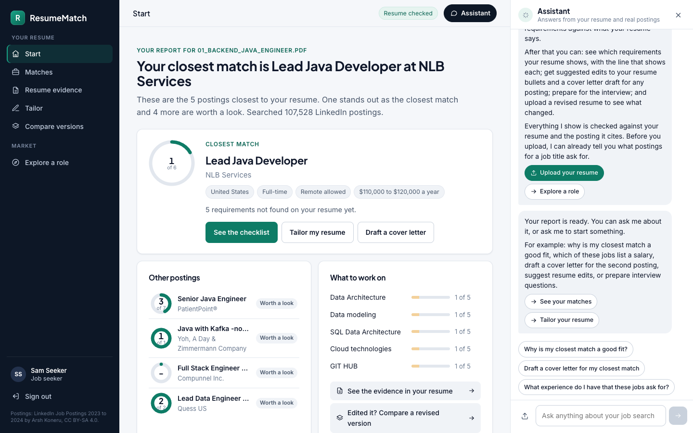
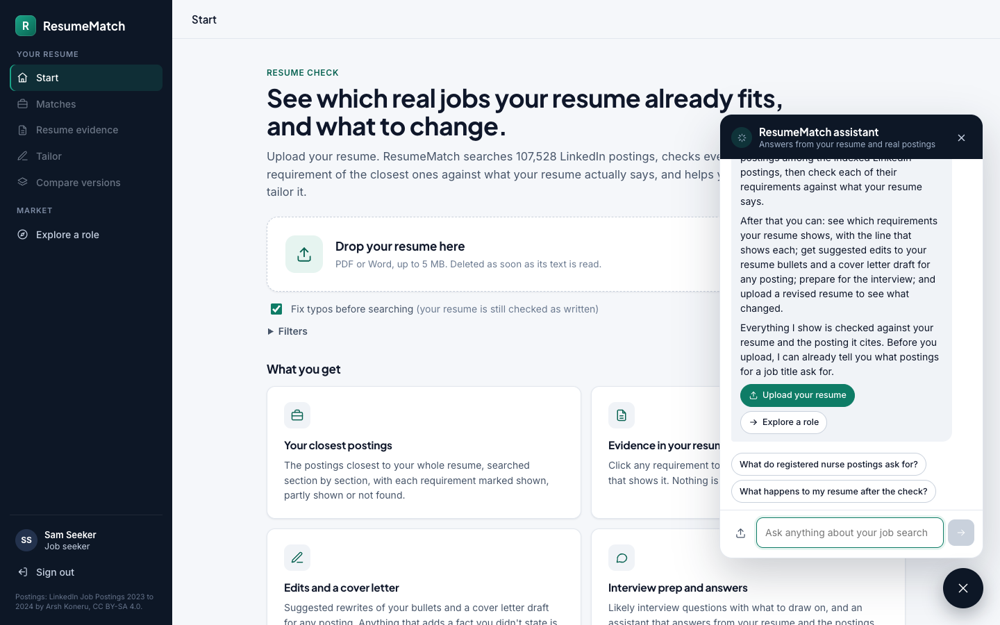
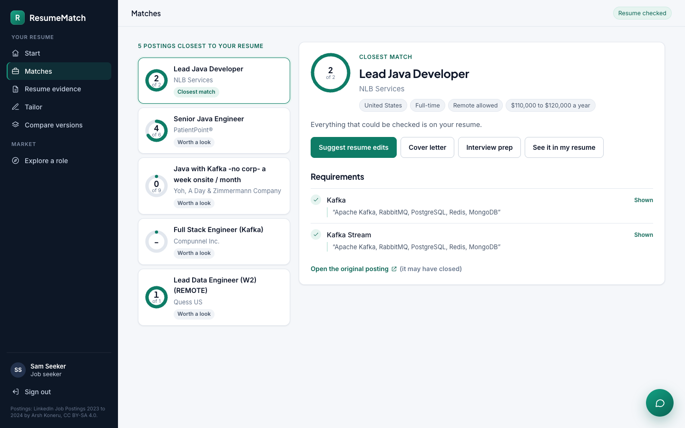
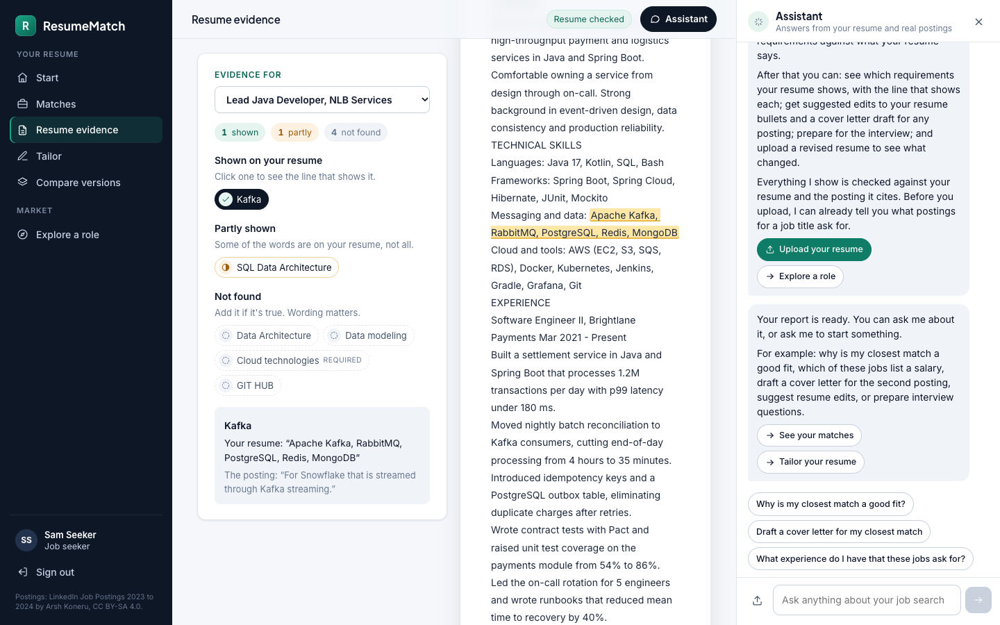
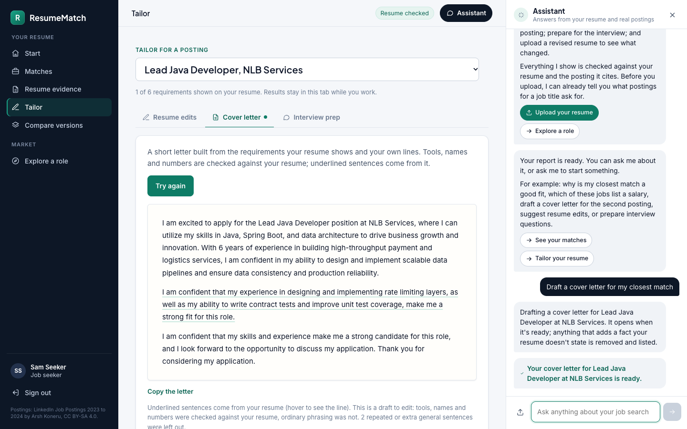
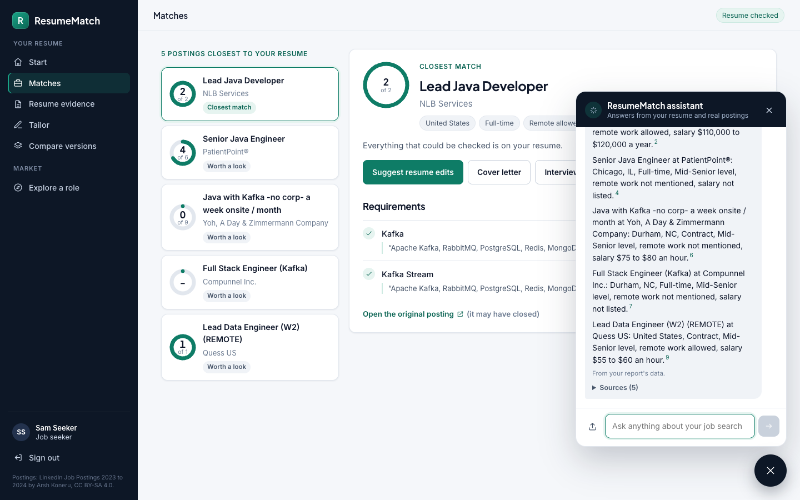
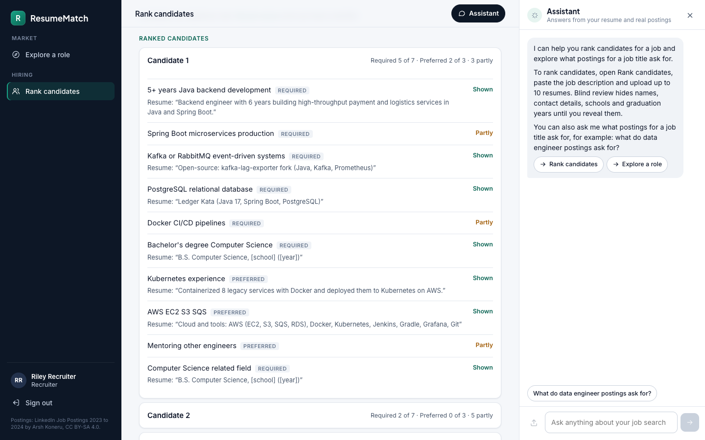
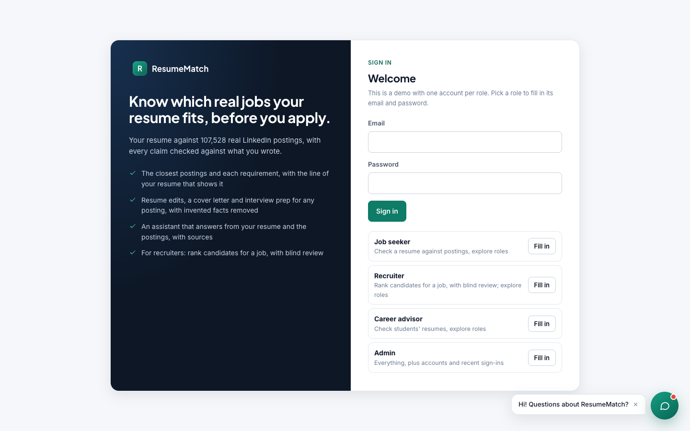
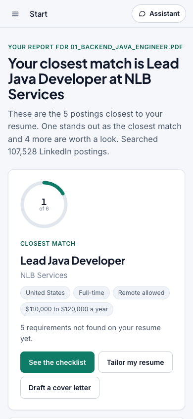

# ResumeMatch

Compares a resume with 107,528 real job postings and shows which requirements it meets, with
every claim checked against the resume and the posting it came from. Around that check it offers
tailoring, interview prep, an assistant, and a recruiter mode with blind review.

[](https://github.com/PubuduGunasekara/rag-resumematch/actions/workflows/ci.yml)
[](LICENSE)

Started in Fall 2026 as an NLP course project at Northeastern (CS6120). This repository is my own portfolio version, designed and built by me.

Built with Claude Code assistance; the design, experiments and measurements are mine.



## What it does

Instead of scoring one resume against one posting, it searches thousands of postings from a
single resume, then checks every claim it shows against the resume and the posting it cites.

| For | Feature | Where in the site |
|---|---|---|
| Job seekers and advisors | The closest postings, each requirement marked shown, partly shown or not found, with the resume line that shows it | Start, Matches |
| | The resume as written, with the evidence for any requirement highlighted on click | Resume evidence |
| | Rewrites of resume bullets, a cover letter draft and interview questions for any posting, with invented facts removed | Tailor |
| | A revised resume checked against the same postings, to see what the edit changed | Compare versions |
| | Search filters: remote, state, work type, level, minimum salary | Start |
| Everyone | What postings for a job title ask for, across all of them, and which of those terms a resume uses | Explore a role |
| | An assistant, open from sign-in, that explains the system, takes a resume, answers questions with sources and starts work on request | Beside every page |
| Recruiters | Up to 10 resumes ranked against a job description, with blind review | Rank candidates |
| Admins | Everything above, plus accounts and recent sign-ins | Admin |

## Key results

| Measure | Result | Measured on |
|---|---|---|
| Corpus | 107,528 postings in 237,902 chunks | Full LinkedIn dataset (123,849 rows) after removing 7 empty and 16,314 duplicate postings |
| End-to-end time per resume | 13.8 s median (11.4 to 19.4 s) | M3 Pro laptop, Ollama on the Metal GPU, 3 resumes, 9 runs |
| End-to-end, everything in Docker on CPU | 57 s median (35.5 to 72.3 s) | Docker Desktop on the same Mac (11 CPUs, 8 GB), 3 resumes, 6 runs |
| Where the time goes | About 96% is the model writing its answer; search and fusion take 0.08 to 0.23 s | Same native runs, `scripts/benchmark.py` |
| Unsupported claims from the model, before the checks | 35 of 48 "matched" claims (73%) cited a posting that didn't mention them | 6 runs, one resume, `llama3.2:3b` |
| Shown claims that fail the app's own checks | 0 of 91 (26 of 184 model claims dropped) | 4 resumes, 2 runs each, `scripts/audit_grounding.py` |
| Vector search recall against exact search | 0.972 mean recall@30 (0.791 before tuning) | 17 resumes, 91 sections |
| Typo correction, top-10 overlap with the clean result at 10% typos | 0.68 to 0.82 without correction, 0.88 to 0.98 with | 4 resumes, 5 seeds each |
| Typo correction, false corrections on clean resumes | 6 words in 35 files (45 before the name and word-form rules) | The synthetic resumes in `eval/resumes/` and one test resume |
| Chunks containing legal boilerplate | 26.9% before cleanup, 2.9% after | Full index |
| Tests | 353 passing, ruff clean | No model, index or network needed |

Every number above has a source in [docs/design.md](docs/design.md#numbers-and-their-sources).

## How it stays honest

A 3B language model running on a laptop is fast, free and private, but it misquotes resumes,
cites the wrong posting and lists employee benefits as skills. So the model only proposes. For
each requirement it claims, code checks that the cited posting asks for it, that the resume quote
really is in the resume, and that a "missing" skill isn't actually listed. Only claims that pass
are shown, and the rest are listed with the reason they failed. Rankings and verdicts are computed
in code, never asked of the model. Every later feature follows the same rule: the model writes,
code decides what is shown.


**What has been audited.** `scripts/audit_grounding.py` runs the full pipeline and re-applies the
app's own checks to everything it shows. Over 4 resumes and 2 runs each, 0 of 91 shown claims
failed a check, and 26 of the model's 184 claims were dropped because no retrieved posting
mentioned them. Because the audit reuses the app's checks, this shows that the pipeline enforces
its rules on real output. It does not show that the output is correct: that needs hand-labelled
claims, which don't exist yet ([grounding-audit](docs/engineering-log.md#grounding-audit)).

## How it works


The postings are indexed once. Each upload then goes through ten steps. Details, parameters and
the reasoning for each are in [docs/design.md](docs/design.md).

1. **Upload** a PDF or Word file (5 MB limit, one analysis at a time).
2. **Validate** that it is a real, readable resume before any model runs. A non-resume gets a
   warning the user can override.
3. **Fix typos** by edit distance against a 159,808-word vocabulary from the postings, for the
   search only.
4. **Split into sections** of at most 480 tokens, because the embedding model ignores text past
   512 tokens.
5. **Search** each section (`bge-small-en-v1.5`, ChromaDB) and combine the rankings per posting
   with reciprocal rank fusion. Keep the top 5, at most 2 per company, within any search filters.
6. **Keep the requirement sentences** of each posting, dropping benefits and company blurbs.
7. **Ask the local model** (`llama3.2:3b` through Ollama) once, with a JSON schema enforced.
8. **Check every claim** in code, as in the diagram above.
9. **Build a report per posting:** shown, partly shown or not found for each requirement, the
   closest match, and what to work on across postings.
10. **Show the result** with the evidence highlighted in the resume. The uploaded file is then
    deleted.

## The site

The Next.js site is a workspace with a sidebar, the page in the middle and the assistant on the
right. A FastAPI service runs the pipeline behind it. All wording and highlight positions come from
the Python code. Streamlit is kept as a quick local tool with the same report and no sign-in.

| Page | What it holds |
|---|---|
| Start | Before a resume: what to expect, the upload and the filters. After: the closest match with its fit ring, the other postings and what to work on across them |
| Matches | Every posting as a card, with its full checklist and links to tailoring |
| Resume evidence | The resume as written. Requirements are grouped by status; clicking one highlights the line that shows it, next to the posting's own sentence |
| Tailor | A posting picker and three tabs: resume edits, cover letter, interview prep |
| Compare versions | A revised resume against the same postings and requirements |
| Explore a role | The role report for any job title |
| Rank candidates | Recruiter mode |
| Admin | Accounts, recent sign-ins and index size |

**The assistant** is open beside every page after sign-in. Routing is code (`chat/assistant.py`),
so it can only offer features that exist:

- "What can you do?" or a greeting: what the system does for this role, and the next step.
- "What do data engineer postings ask for?": the role report's top terms, before any resume.
- "Draft a cover letter for the second posting", "suggest resume edits", "prepare me for the
  interview": the site runs it and opens the result on the Tailor page.
- A request that needs a resume before there is one: it asks for the resume, and takes it in the chat.
- Any other question about the report: answered with sources (see below).

The report, tailoring results and conversation stay in the browser tab, survive a reload, and are
cleared on sign-out. On a phone the sidebar becomes a menu and the assistant a bottom sheet.
([workspace-redesign](docs/engineering-log.md#workspace-redesign))

### Screens

Captured from the running site with the full index, signed in as the demo job seeker and recruiter.

| | |
|---|---|
|  |  |
| **Start**, before a resume: what to expect, the upload, and the assistant's welcome | **Matches**: every posting with its fit ring and full checklist |
|  |  |
| **Resume evidence**: Kafka selected, and the line that shows it highlighted | **Tailor**: a cover letter drafted on request in the assistant, with the failed sentences listed |
|  |  |
| **Assistant**: a salary question answered from the postings' data | **Rank candidates**: blind review, with the school and year removed from the evidence |
|  |  |
| **Sign in**: one-click demo accounts | **Phone width**: the same overview, with the menu and assistant behind buttons |

## The features in detail

### Role report

Reads every indexed posting with a given title, for example 331 for Data Engineer and a fixed
sample of 1,000 of the 2,305 Registered Nurse postings, and lists the terms their requirement
sentences use most. A term is kept only when it appears at least 3 times as often as in a fixed
sample of 3,000 postings of any kind, so words every posting uses drop out without a hand-made
skill list. With a resume, each term is marked as on it or not. No language model is involved; a
report takes 0.6 to 2.1 s. ([role-report](docs/engineering-log.md#role-report))

### Search filters

Both reports can be limited to postings that allow remote work, are in one state, have a given
work type or level, or list at least a set salary per year (hourly pay counted as 2,080 hours).
Level is stated on 75% of postings and a salary on 31%, so those filters leave out postings that
don't state one, and the report says so. The filters apply inside the search: with 2,500 or fewer
passing postings ChromaDB searches only those, and above that it fetches 20 times more chunks and
drops the rest, which took 0.1 to 1.0 s. ([search-filters](docs/engineering-log.md#search-filters))

### Tailoring: resume edits, cover letter, interview prep

A rewrite of a resume bullet is rejected if it adds a number, a tool the bullet doesn't name, or a
word the resume doesn't use (apart from filler words, verb forms and a few generic nouns). A cover
letter sentence is rejected if it states a number from neither the resume nor the posting, or
claims a tool the resume doesn't have; sentences that rest on the resume are underlined. Every
rejection is listed with its reason. In one run on three resumes, 3, 5 and 4 of 6 rewrites passed;
rejected ones added "Cosmos DB" (asked for by the posting, not on the resume) and "cardiac" (an ICU
nurse applying to a cardiac ICU). ([tailoring](docs/engineering-log.md#tailoring))

Interview prep lists the question an interviewer is likely to ask about each requirement, gaps
first. The model only phrases the questions; what to draw on comes from code: the verified resume
line, the words a partial match does show, or an honest-answer hint for a gap. A question that
fails a check is replaced by a template, so every requirement gets one. It takes 2 to 6 s.
([interview-prep](docs/engineering-log.md#interview-prep))

### Questions about the report

Questions the report's data answers exactly are answered by code: why the closest match fits, and
salary, remote, location, work type and level. A question unrelated to the resume or postings is
declined without calling the model. For everything else the model writes a few sentences citing
numbered pieces, and code removes any sentence that cites nothing, states a number or names a tool
not in what it cites, or says the candidate has something taken from a posting that the resume
doesn't show. On a resume that says "Level I trauma center", that check removed "You have
experience in a Level II Trauma center". It does not catch a sentence that misreads the resume's
own words, such as "You have the CPA certification" for "CPA candidate", so sources are shown
under every answer. Code answers took 0.1 to 2 s and model answers 2 to 7 s.
([ask-report](docs/engineering-log.md#ask-report))

### Comparing a revised resume

The revised file is checked against the same postings and requirements as the report, with one
rule and no model for both versions (one line holding all of a requirement's key words, or two
thirds of them when it has more than two), so a change comes from the edit rather than from the
model answering differently. Parsing and comparing took about 40 ms.
([version-compare](docs/engineering-log.md#version-compare))

### Recruiter mode

The model lists the job's requirements once; code keeps only those in the description and reads
"required" or "preferred" from its wording or the heading above. Every resume is then checked
against the same requirements by the same rule, with no model per candidate, so the model
answering differently can't favor anyone. Candidates are ranked by required requirements shown,
then preferred, then partial matches. Blind review, on by default, removes names, contact details,
links, the header location, school names and graduation years from everything shown, and labels
candidates by rank until "Reveal names". With one job description and four resumes, two runs gave
the same 9 requirements and the same order, in about 2 s for the model and under 0.1 s for the
ranking. ([recruiter-mode](docs/engineering-log.md#recruiter-mode))

## What went wrong first

Each of these is a real failure I measured, with the fix and the numbers in the
[engineering log](docs/engineering-log.md).

- **The search read half the resume.** The embedding model ignores text past 512 tokens, so a
  1,015-token resume was searched on its first 510 tokens, with no error. Searching section by
  section fixed it. ([resume-truncation](docs/engineering-log.md#resume-truncation))
- **Typo correction rewrote names.** It changed "Redis" to "Hedis" and the company "Midstate" to
  "Mistake". A full-corpus vocabulary and rules for names, acronyms and real words brought false
  corrections on 35 clean files from 45 to 6.
  ([vocab-full-corpus](docs/engineering-log.md#vocab-full-corpus),
  [false-corrections](docs/engineering-log.md#false-corrections))
- **73% of the model's matches were unsupported.** In 6 runs, 35 of 48 "matched" requirements
  cited a posting that never mentioned them. That led to checking every claim from both sides.
  ([two-sided-grounding](docs/engineering-log.md#two-sided-grounding))
- **Employer benefits came back as skills to learn**, such as "403(b) retirement plan". They are
  now filtered in code. ([four-resumes](docs/engineering-log.md#four-resumes))
- **A prompt instruction made the model list less.** Telling it "never list what the employer
  offers" cut real findings from 2.8 to 0.2 per run and didn't remove the benefits.
  ([benefits-prompt-ab](docs/engineering-log.md#benefits-prompt-ab))
- **The chat credited postings' requirements to the candidate.** Words from a posting were
  presented as the candidate's experience until a claim about the candidate had to be backed by
  the resume. ([ask-report](docs/engineering-log.md#ask-report))

## Try it

You need Python 3.11 or 3.12 and [Ollama](https://ollama.com). The fastest path uses a prebuilt
sample index of 2,000 postings (37 MB), so no Kaggle account or dataset download is needed. On a
fresh clone on my M3 Pro this reached its first result in about 2.5 minutes, not counting the
one-time 2 GB model download ([details](docs/engineering-log.md#fresh-clone)).

```bash
git clone https://github.com/PubuduGunasekara/rag-resumematch.git && cd rag-resumematch
python3.12 -m venv .venv && .venv/bin/pip install -r requirements.txt && .venv/bin/pip install -e .
.venv/bin/python scripts/fetch_sample_index.py   # downloads and checks the sample index
ollama pull llama3.2:3b
cp .env.example .env                              # the demo accounts work as is
```

Then start the API and the site, and open http://localhost:3100:

```bash
.venv/bin/uvicorn resumematch.api.app:app --host 127.0.0.1 --port 8000
cd web && npm install && npm run dev
```

Or run everything in Docker: `docker compose -f docker-compose.local.yml up --build`.

**Demo accounts.** All four use the password **resumematch-demo**; on the login page, "Fill in"
next to a role enters both.

| Account | Role | Can use |
|---|---|---|
| seeker@example.com | Job seeker | Resume check, tailoring, compare, role report, assistant |
| advisor@example.com | Career advisor | The same as a job seeker |
| recruiter@example.com | Recruiter | Rank candidates, role report, assistant |
| admin@example.com | Admin | Everything, plus the admin page |

Upload one of the synthetic resumes in [eval/resumes/](eval/resumes/) (20 fictional people, from
backend engineer to teacher; see its MANIFEST.md) so you don't have to use your own. With the
2,000-posting sample index the matches are weaker than with the full corpus. To build the full
index, add Kaggle credentials to `.env` and run `.venv/bin/python scripts/build_index.py` (about
40 minutes on an M3 Pro, 531 MB download).

The demo password is public on purpose, so anyone can try the system. To close a deployment, set
your own `DEMO_PASSWORD` and `DEMO_PASSWORD_PUBLIC=0` in `.env`. If something is missing (no
index, Ollama not running, model not pulled), the site says so with the command that fixes it.

| Command | What it does |
|---|---|
| `make setup` | Create `.venv` and install everything |
| `make test` | Run the 353 unit tests |
| `make lint` | Run ruff with the rules in `pyproject.toml` |
| `make sample-index` | Download the prebuilt 2,000-posting sample index |
| `make index-small` | Build a 2,000-posting index yourself (needs Kaggle credentials) |
| `make api` and `make web` | Start the API and the site |
| `make run` | Start the Streamlit app |
| `make eval` | Run the typo-correction and coverage evaluations |
| `make benchmark` | Time each pipeline stage and print the hardware it ran on |

## Testing

`make test` runs 353 tests in about 4 seconds with no model, index or network: the model, the
vector store and the embedder are replaced by small fakes. Every bug in the engineering log has a
regression test.

| Area | Tests | What they cover |
|---|---|---|
| Resume input | 83 | PDF and Word parsing, tables and two-column layouts, the 20 synthetic resumes, validation, section splitting, contact redaction |
| Model output and claim checks | 69 | Parsing the JSON answer, every grounding check, tiers, the report, text cleanup, the pipeline |
| Features | 77 | Role report, tailoring checks, interview prep, version compare, recruiter ranking and blind review, the chat checks, assistant routing |
| API, sign-in and health | 49 | Every endpoint, roles (401 and 403), sessions, tampered and expired tokens, failed-attempt limits, startup checks |
| Index building | 28 | Chunking, boilerplate removal, the sample-index download and checksum |
| Typo correction | 26 | Guard rails for names, acronyms and real words, and the false corrections measured on real resumes |
| Retrieval and filters | 21 | Reciprocal rank fusion, per-company caps, filter matching, salary conversion, both filtering paths |

Measurements that need the model or the full index are scripts, not unit tests:
`scripts/eval_query_correction.py`, `scripts/eval_search_recall.py`,
`scripts/audit_grounding.py` and `scripts/benchmark.py`. Their results are in the Key results table
and the engineering log.

## Limitations and what's next

- **The checks compare wording.** A requirement phrased differently from the resume shows as not
  found (NetSuite on a resume doesn't satisfy "ERP system"). Errors go toward "not found", never
  toward a false match.
- **The 3B model misreads sometimes.** In chat answers it can misread the resume's own words, and
  it rephrases job requirements loosely. Sources are shown so a reader can check.
- **Only synthetic resumes so far.** 20 fictional resumes in 16 fields. Real resumes, and scanned
  or image-heavy PDFs, are untested.
- **No ground-truth labels.** Retrieval quality and the precision of the checks haven't been
  measured against hand labels.
- **The vector search is approximate.** It returns 97% of the true 30 nearest chunks on average,
  with a few sections near 70%. ([search-recall](docs/engineering-log.md#search-recall))
- **Demo accounts are fixed in code.** Recent sign-ins live in memory; nothing about a user is
  stored.
- **One analysis at a time.** A second request during a model call is asked to wait.

Planned next: relevance labels for the evaluation resumes, a precision measurement for the claim
checks, a run on the GPU VM to compare a larger model, and screenshots of the current design.

## Design decisions

| Choice | Alternative tried | Why |
|---|---|---|
| Sections of at most 480 tokens | Whole resume as one query | One query saw 50% of a 1,015-token resume |
| Reciprocal rank fusion, k = 60 | Not compared yet | Standard value; combines rankings without calibrating distances |
| HNSW search_ef 200 | ChromaDB default (10) | Recall@30 against exact search 0.972 vs 0.791, and repeatable results, at the same query time |
| `llama3.2:3b` | `llama3.1:8b` | 12 s vs 29 s per resume with the schema, and 8B backed claims with irrelevant quotes (one resume) |
| JSON-schema constrained output | Text format with a retry | 8 of 8 usable on the first try vs 4 of 8, 12 s vs 32 s (one resume) |
| At most 2 postings per company | No cap | One staffing agency otherwise took 6 of the top 10 |
| Tiers from search rank plus a credential check | Share of requirements met | The share rule called an ICU nurse "not a match" for an ICU job |
| Code answers for fit and facts questions | The model answering them | The model listed jobs as having a salary when their facts said "not listed" |
| One lexical rule for every recruiter candidate | The model per candidate | The model answers differently between runs, which would favor some candidates |

The full table, with sources, is in [docs/design.md](docs/design.md#decisions).

## Privacy and security

- **Local processing.** Parsing, search and the language model run on the machine running
  ResumeMatch; no resume text is sent to an outside service. Uploaded files are deleted as soon as
  their text is read.
- **Nothing stored.** The report and the conversation live in the browser tab and are cleared on
  sign-out. Server error logs record the error type and stack, never the message, because a message
  could quote a resume.
- **Telemetry off.** ChromaDB, Streamlit and Next.js telemetry are disabled. The network is used
  only for the one-time dataset and embedding model downloads.
- **Sign-in.** The shared demo password is kept only as a salted scrypt hash. The session is a
  signed token in an HttpOnly cookie that page scripts can't read, valid for 8 hours. Five failed
  attempts in 5 minutes block an account until the window passes. The API checks the role on every
  request; the site only hides links a role can't use.

## Deployment

- **Laptop:** the API and site natively or in Docker, with Ollama running natively to use the GPU.
- **Docker:** `docker-compose.local.yml` starts Ollama, the API and the site; only the site's port
  (3100) is published. Built and run on my Mac with the full index: images built in 2 min 8 s, and
  sign-in, role checks, a role report (2.3 s), a resume check (23 s) and the chat worked through the
  site container. ([docker-site](docs/engineering-log.md#docker-site))
- **GPU VM:** `docker-compose.gcp.yml` with `gcp/start.sh` and `gcp/stop.sh` runs the same services
  on a GCP VM with a T4 GPU, about $0.50 to $0.55 an hour, or over $350 a month if left running.
  This profile has not been run yet.

## Project layout

```
src/resumematch/
  ingest/        parse_resume.py, validate.py, job_postings_loader.py
  preprocess/    chunker.py, boilerplate.py, resume_sections.py, query_correction.py, redact.py
  retrieval/     embedder.py, vector_store.py, fusion.py, filters.py
  generation/    ollama_client.py, gap_analysis.py, job_report.py, tailor.py, interview.py, compare.py
  market/        role_profile.py (role report)
  recruit/       rank.py (rank resumes for a job), blind.py (blind review)
  chat/          ask.py (questions with sources), assistant.py (routing)
  api/           app.py (FastAPI), auth.py (sign-in and roles)
  frontend/      streamlit_app.py, render.py
  pipeline.py    runs steps 2 to 9 for one resume
web/
  app/           start, matches, resume, tailor, compare, role, recruit, admin and login pages
  components/    AppShell, Assistant, ReportParts, Tailor, Compare, Filters
  lib/           session (sign-in, roles), workspace (the report shared by every page)
scripts/         build_index.py, fetch_sample_index.py, make_sample_index.py, eval_*.py,
                 benchmark.py, audit_grounding.py
tests/           353 unit tests
eval/resumes/    20 synthetic test resumes (fictional people), see MANIFEST.md
docs/            design.md, engineering-log.md, diagrams/, images/
gcp/             start.sh, stop.sh for the GPU VM
```

## Reading guide

- **5 minutes:** this README.
- **30 minutes:** [docs/design.md](docs/design.md), for the architecture, every decision with its
  measured reason, what has and hasn't been verified, and where each number comes from.
- **Deep dive:** [docs/engineering-log.md](docs/engineering-log.md), the dated record of 36
  experiments and fixes, and [tests/](tests/).

## Dataset and license

The code is under the [MIT License](LICENSE).

The job postings come from LinkedIn Job Postings (2023 to 2024), collected by
[ArshKA](https://github.com/ArshKA/LinkedIn-Job-Scraper) with 100,000 more postings added by
`zoeyyuzou`, published on [Kaggle](https://www.kaggle.com/datasets/arshkon/linkedin-job-postings)
under [CC BY-SA 4.0](https://creativecommons.org/licenses/by-sa/4.0/). The dataset is not included
in this repository. Any processed version of it, such as a built index, stays under CC BY-SA 4.0
and needs the same attribution. The sample index published with the releases carries its own
ATTRIBUTION.md listing what was changed.

## Author

Pubudu Gunasekara ([GitHub](https://github.com/PubuduGunasekara))
