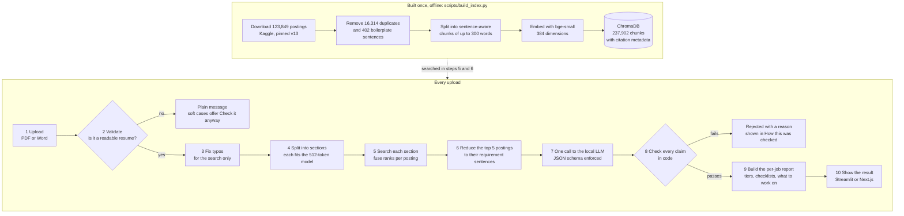
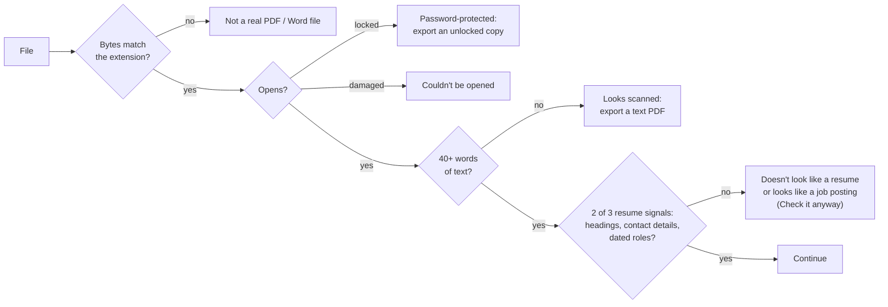
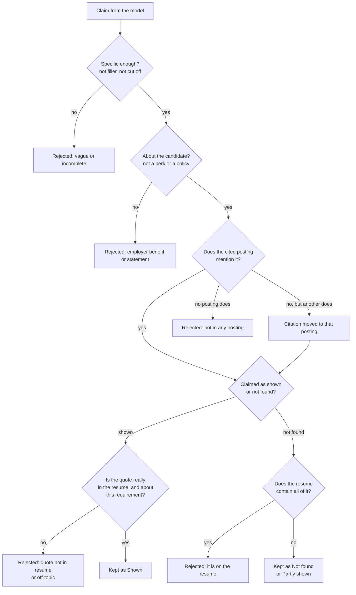

# ResumeMatch

**Check a resume against 107,528 real job postings, with every claim verified.**

ResumeMatch finds the job postings closest to a resume, checks each requirement against what
the resume actually says, and shows what to work on before applying. It is a
retrieval-augmented generation (RAG) system written from scratch: a local language model
proposes requirements, and code verifies every one of them against the resume and the posting
it cites before anything reaches the screen.

Built for CS6120 (Natural Language Processing) at Northeastern University, Fall 2026.


| | |
|---|---|
| **Corpus** | 123,849 LinkedIn postings, 107,528 after removing duplicates, 237,902 indexed chunks |
| **Model** | `llama3.2:3b`, running locally through Ollama. No paid API, no data leaves the machine |
| **Speed** | About 20 s per resume on a laptop (M3 Pro); retrieval itself takes 0.04 s |
| **Front ends** | A Streamlit app (the course UI) and a Next.js site, sharing one Python pipeline |
| **Tests** | 152 unit tests; every design change measured and recorded in the [engineering log](docs/engineering-log.md) |

## Contents

1. [Overview](#overview)
2. [Step by step, from upload to result](#step-by-step-from-upload-to-result)
3. [Building the index](#building-the-index)
4. [What the checks guarantee](#what-the-checks-guarantee)
5. [Results so far](#results-so-far)
6. [Running it](#running-it)
7. [Project layout](#project-layout)
8. [Dataset and license](#dataset-and-license)

## Overview

The resume is the query; the job postings are the indexed documents. The index is built once,
offline. Each upload then runs through the steps below.



The main idea: **the model suggests, the code decides.** A 3B model is fast and free to run
locally, but it misquotes, cites the wrong posting, and lists perks as skills. So nothing it
says is shown until code has confirmed it against the source text. Rankings and verdicts are
computed in code, never asked of the model.

## Step by step, from upload to result

Each step names the file that implements it, so the README doubles as a map of the code.

### 1. Upload

**What happens.** The user drops a PDF or Word file onto the page. The browser checks the
extension before uploading. The server then checks it again, refuses empty files and files
over 5 MB, and runs one analysis at a time: a second request while one is running gets a
clear "try again in a minute" instead of a silent queue, because a local model on one GPU
gets slow for everyone if it serves two at once.

**Where.** `web/app/page.tsx`, `src/resumematch/api/app.py`, `src/resumematch/frontend/streamlit_app.py`

### 2. Validate: is this a resume we can read?

**What happens.** Before any model is loaded or called, the file goes through four layers. The
first one that fails decides the message.



**Why structure and not similarity.** The obvious approach would be to accept anything that
resembles job-related text. Measured, that fails exactly where it matters: a cover letter
(similarity 0.710) and a job posting (0.806) scored *higher* than every real resume (0.556 to
0.687). Structure separates them cleanly: resumes have section headings, contact details and
dated roles; those documents don't. The last layer is a warning, not a block, because a
heuristic should never stop a real person with an unusually formatted resume.

**Where.** `src/resumematch/ingest/validate.py`, `src/resumematch/ingest/parse_resume.py`

### 3. Fix typos, for the search only

**What happens.** Words the corpus has never seen are corrected by edit distance against a
vocabulary of 159,808 words built from every posting. This is the autocorrect from
Assignment 3, adapted with guard rails learned from false corrections: short words, acronyms
and mixed-case words are never changed, two-edit corrections are allowed only on long words,
and capitalized words in mid-line (often names) get one-edit fixes only. That last rule exists
because "Midstate" was once corrected to "Mistake". The corrected text is used only for the
search; the model and the checks read the resume exactly as written, and every change is
listed on the results page.

**Why.** Typos and PDF extraction artifacts change which postings come back. With 10% of
words damaged, correction raised overlap with the clean result from 0.60 to 0.86 up to 0.94 to
1.00, with zero false corrections on four clean resumes.

**Where.** `src/resumematch/preprocess/query_correction.py`

### 4. Split the resume into sections

**What happens.** The resume is split at its headings (a list of common headings, ALL CAPS
lines, and Title Case lines containing a heading word such as "Work History"). Fragments under
12 words are merged forward, and any section longer than 480 tokens is split evenly at line
breaks. A resume with no detectable headings falls back to even, fixed-size windows.

**Why.** The embedding model reads at most 512 tokens and silently drops the rest. Embedded
as one query, a 1,015-token test resume lost its entire experience and skills sections: the
search saw 50% of it, without any error. Searched as sections, it sees 100%, and the page can
say which part of the resume matched each posting.

**Where.** `src/resumematch/preprocess/resume_sections.py`

### 5. Search and fuse

**What happens.** Each section is embedded with `bge-small-en-v1.5` and retrieves its 30
nearest chunks from ChromaDB. The per-section rankings are combined per posting with
reciprocal rank fusion: each posting scores the sum of 1 / (60 + its rank) across sections, so
a posting that several sections agree on beats one that a single section ranks highly. At
most two postings per company are kept, then the top 5.

**Why.** Rank fusion needs no score calibration between sections and has one standard
parameter. The company cap stops one employer's near-identical listings from filling the
results.

**Where.** `src/resumematch/retrieval/embedder.py`, `vector_store.py`, `fusion.py`

### 6. Reduce each posting to its requirements

**What happens.** Search returns each posting's best-matching chunk, but the requirements can
be anywhere in it, so all of each posting's chunks are fetched. Sentences about the employer
(perks, mission statements, "we offer") are dropped, sentences with requirement cues
("must", "required", "preferred", "experience", "degree") are kept first, and each posting is
capped at about 260 words so all five fit in one prompt.

**Where.** `requirement_excerpt` in `src/resumematch/generation/job_report.py`

### 7. One call to the local model

**What happens.** The five excerpts and the resume go to `llama3.2:3b` in a single prompt:
postings first, numbered, and the resume last, fenced between markers so the model can tell
which text describes the candidate. The model returns up to 12 matched and 12 not-found
requirements, each citing a posting by number, with matched ones quoting the resume. Decoding
is constrained by a JSON schema, so the output always parses and a citation outside 1 to 5
cannot be generated. Temperature is 0.2 and the context window is set explicitly to 8,192
tokens (Ollama's default of 4,096 was 96% full on a real prompt and would silently drop text).
An unusable answer is retried once with a reminder.

**Why one call and not one per job.** Measured: five per-job calls took 60 to 68 s and filled
the checklists with company blurbs ("Best Place to Work"). One pooled call takes 16 to 21 s,
and since every claim already cites a posting, grouping claims by posting gives per-job
checklists at no extra cost. Asking for requirements "from every excerpt" doubled per-job
coverage on two of three resumes.

**Where.** `src/resumematch/generation/gap_analysis.py`, `ollama_client.py`

### 8. Check every claim in code

**What happens.** Each claim the model makes goes through these checks. A claim that fails is
removed and listed, with its reason, in the "How this was checked" panel.



Matching is done on normalized text (case, punctuation and line breaks ignored), with plurals
folded ("certifications" matches "certification") and a short synonym list so that
"advanced cardiac life support" matches "ACLS" and "critical care" matches "intensive care
unit". The model's own wording is cleaned of em dashes and emoji; quotes from the resume and
postings are always shown exactly as written.

**Why.** Every rule here started as a real failure in testing: the model quoted posting text
as if it were the resume, matched "Java" to a posting that never mentions Java, listed "AWS" as
missing from a resume that lists AWS, and listed "403(b) retirement plan" and "Child care" as
skills to learn. An earlier attempt to fix the benefits by instructing the model ("never list
what the employer offers") was measured and rejected: it cut real findings from 2.8 to 0.2 per
run without reducing the benefit claims at all.

**Where.** `check_claims` in `src/resumematch/generation/gap_analysis.py`, `text_clean.py`

### 9. Build the per-job report

**What happens.** The verified claims are grouped by the posting they cite. For each
requirement the report works out:

- **Status:** *Shown* (with the resume quote), *Partly shown* (the resume has at least two of
  its key words, which are listed), or *Not found on your resume*.
- **Importance:** *required* or *preferred*, read from the clause of the posting that states
  it ("BLS required; ACLS preferred" gives each its own answer).
- **Credential or not:** degrees and licenses are flagged, because rewording a resume can't
  add one.
- **Soft skills** such as "clinical judgment" are listed separately and not counted, since no
  resume line can confirm or refute them.

Jobs are then placed in tiers:

| Tier | Rule |
|---|---|
| **Closest match** | The best-ranked posting by retrieval that doesn't ask for a missing required credential |
| **Also worth a look** | Every other posting without such a gap |
| **Not a match right now** | Asks for a required degree or license the resume doesn't show; the card says which |

Across the postings, gaps are grouped by meaning ("Cardiogenic shock" and "Cardiogenic shock
experience" are one item) into **What to work on**, ordered by how many postings ask for it.
If nothing at all could be confirmed, the report says "We couldn't connect this document to
job requirements" instead of naming a closest match.

**Why tiers don't come from a score.** An early version ranked jobs by the share of
requirements met. It labelled an RN ICU posting "not a match" (1 of 9) for a nurse with six
years of ICU experience, because the model listed granular items ("experience in renal
failure") that a resume never names word for word. A word check can confirm something is on a
resume but can't prove it's absent, so a "met" ratio is not a fair verdict. Retrieval
similarity plus a hard-credential gate is.

**Where.** `src/resumematch/generation/job_report.py`

### 10. Show the result

**What happens.** Both front ends render the same report, and every sentence a user reads is
produced by the Python code, so they always agree:

- The **closest match** with location, work type, seniority and pay where the posting lists
  them, a requirement checklist with the resume quote for each item, and a link to the
  original posting.
- **Other postings** as rows that expand into the same checklist.
- **What to work on** across all five postings.
- **The resume itself**, with the evidence for the selected job highlighted. Highlight
  positions are computed in Python and sent to the page, so both front ends mark exactly the
  same text.
- **How this was checked:** the resume sections searched, the postings retrieved and which
  sections found them, every typo fix, and every rejected claim with its reason.

The uploaded file is deleted as soon as the check finishes.

**Where.** `src/resumematch/frontend/render.py` and `streamlit_app.py`; `src/resumematch/api/app.py`
(JSON for the site); `web/components/Report.tsx`


## Building the index

Run once with `scripts/build_index.py` (about 40 minutes on a laptop for the full corpus):

1. **Download** the dataset with `kagglehub`, pinned to version 13 (an unpinned download broke
   once when the file layout changed between versions).
2. **Skip exact duplicates:** 16,314 postings whose normalized description was already seen.
3. **Find boilerplate:** a sentence that appears in at least 20 postings from at least 10
   different companies, or that matches legal patterns (equal opportunity, accommodation), is
   removed, unless it states a requirement such as a degree or a lifting limit. This found 402
   sentences and cut the share of chunks containing equal opportunity text from 26.9% to 2.9%.
4. **Chunk:** whole sentences packed into chunks of up to 300 words with about 50 words of
   overlap, so chunks don't end mid-sentence (68.4% end at a sentence boundary, up from 25.9%).
   Short skills lists are folded into the description.
5. **Embed and store** each chunk in ChromaDB with its job ID, title, company and posting URL,
   so every result can be cited without a second lookup.
6. **Write side files** to `data/processed/`: the typo vocabulary, the boilerplate list, and
   posting details (location, work type, seniority, pay) for the job cards. A
   `BUILD_COMPLETE.json` marker is written last, so an interrupted build is never mistaken
   for a finished one.

## What the checks guarantee

- A requirement marked **Shown** has an exact quote from the resume that mentions it.
- Every requirement listed is asked for by the posting it is shown under.
- Employer benefits, company descriptions, legal statements and cut-off phrases are never
  presented as requirements.
- A job is only called **not a match** when it asks for a required credential the resume
  doesn't show; gaps are worded as *not found on your resume*, never "missing".
- A file that isn't a readable resume gets a plain explanation before any model runs.

What they don't guarantee: the checks compare wording, so a requirement the resume describes
in different words can still appear as *not found*. The page says so, and the user decides.

## Results so far

All numbers are measured; methods and the scripts that produced them are in the
[engineering log](docs/engineering-log.md), which also records the ideas that were rejected.

| What | Result |
|---|---|
| Resume text the search sees | 100%, up from 50% for a 1,015-token resume searched as one query |
| Retrieval with 10% injected typos, correction off / on | 0.60 to 0.86 / 0.94 to 1.00 overlap with the clean result |
| False typo corrections on clean resumes | 0, across 4 resumes from 4 fields |
| Chunks containing legal boilerplate | 2.9%, down from 26.9% |
| Model answers that parse on the first try | 100% with the JSON schema |
| Time per resume, warm (M3 Pro, native Ollama) | 16 to 21 s; retrieval alone 0.04 s |
| Wrong files: fake, damaged, locked, scanned, not a resume | Each gets a specific message; all 4 test resumes pass |

**Known limits.** The 3B model's checklists are thin for some postings and vary between runs.
Word checks miss synonyms outside the synonym list. Retrieval alone doesn't tell a pediatric
posting from an adult one. And so far everything is measured on synthetic resumes, with real
PDFs in unusual layouts still to test.

## Running it

### Setup

```bash
cp .env.example .env   # add KAGGLE_USERNAME and KAGGLE_KEY (Kaggle > Settings > API)
python -m venv .venv
.venv/bin/pip install -r requirements.txt && .venv/bin/pip install -e .
```

### Build the index (once)

```bash
.venv/bin/python scripts/build_index.py              # full corpus, about 40 min
.venv/bin/python scripts/build_index.py --limit 2000 # small index for development
```

For an index built before posting details existed, add them in a few seconds:

```bash
.venv/bin/python scripts/build_posting_details.py
```

### Start the local model

```bash
brew install ollama && brew services start ollama   # macOS: runs on the Metal GPU
ollama pull llama3.2:3b
```

### Streamlit app

```bash
.venv/bin/streamlit run src/resumematch/frontend/streamlit_app.py
# open http://localhost:8501
```

### Next.js site

Two processes: the Python API, and the web server, which forwards `/api` to it.

```bash
.venv/bin/uvicorn resumematch.api.app:app --host 127.0.0.1 --port 8000
```

```bash
cd web && npm install && npm run dev
# open http://localhost:3100
```

Set `API_URL` if the API runs somewhere else (default `http://127.0.0.1:8000`). The API has
`GET /api/health` and `POST /api/analyze` (multipart `file`, optional `correction` and
`allow_unusual`); errors return `{"detail": {"code", "message", "soft"}}`, and interactive
docs are at `http://127.0.0.1:8000/api/docs`.

### Docker (Streamlit app)

```bash
# App in Docker, model in native Ollama on the Metal GPU: about 11 s per resume
OLLAMA_HOST_FOR_APP=http://host.docker.internal:11434 docker compose -f docker-compose.local.yml up

# Everything in Docker, CPU only on a Mac: about 37 s per resume
docker compose -f docker-compose.local.yml up --build
```

On start, the container waits for Ollama, pulls the model if needed, and reuses `./chroma_db`
and `./data/processed` when they hold a complete index; otherwise it builds one. Both folders
are mounted from the host, so the index is built once. `.env` supplies the Kaggle credentials
to Compose and is never copied into the image. Docker currently covers the Streamlit app; the
API and the Next.js site run as shown above.

### GCP (course demo on a GPU)

```bash
source .env
./gcp/start.sh
# On the VM: install the NVIDIA container toolkit and Docker Compose, clone this repo, and
# copy the locally built index instead of rebuilding it on GPU hours:
#   gcloud compute scp --recurse chroma_db data/processed <vm-name>:~/resumematch/ --zone=<zone>
docker compose -f docker-compose.gcp.yml up --build -d
./gcp/stop.sh   # every time; the $50 credit is the whole budget
```

### Tests and evaluation

```bash
.venv/bin/python -m pytest -q        # 152 tests; no model or index needed
.venv/bin/python scripts/eval_query_correction.py RESUME.pdf [MORE.docx ...]
.venv/bin/python scripts/eval_resume_coverage.py RESUME.pdf [--swap nursing|software]
```

Synthetic test resumes from three fields (nursing, accounting, mechanical engineering) are in
`eval/resumes/`. They describe fictional people.

## Project layout

```
src/resumematch/
  ingest/        parse_resume.py, validate.py (upload checks), job_postings_loader.py
  preprocess/    chunker.py, boilerplate.py, resume_sections.py, query_correction.py
  retrieval/     embedder.py, vector_store.py, fusion.py (reciprocal rank fusion)
  generation/    ollama_client.py, gap_analysis.py (prompt, schema, claim checks),
                 job_report.py (per-job report), text_clean.py
  frontend/      streamlit_app.py, render.py (results page HTML)
  api/           app.py (JSON API for the Next.js site)
  pipeline.py    runs steps 2 to 9 for one resume
web/             Next.js site: app/, components/, lib/
scripts/         build_index.py, build_posting_details.py, eval_*.py, wait_for_ollama.py
tests/           unit tests for each module
eval/resumes/    synthetic resumes used for evaluation
docs/            design.md (decisions), engineering-log.md (experiments and evidence), images/
gcp/             start.sh, stop.sh: budget guardrails for the GCP credit
data/            raw/ and processed/ (not in git)
```

## Privacy

Resumes are processed on the machine running ResumeMatch and deleted as soon as each check
finishes. Nothing is stored, and nothing is sent to an outside service.

## Dataset and license

LinkedIn Job Postings (2023 to 2024), scraped by
[ArshKA](https://github.com/ArshKA/LinkedIn-Job-Scraper), with an additional 100,000 postings
contributed by `zoeyyuzou`.
[Kaggle dataset](https://www.kaggle.com/datasets/arshkon/linkedin-job-postings), licensed
[CC BY-SA 4.0](https://creativecommons.org/licenses/by-sa/4.0/). Any processed or derivative
form of this data distributed from this project remains under the same license.
