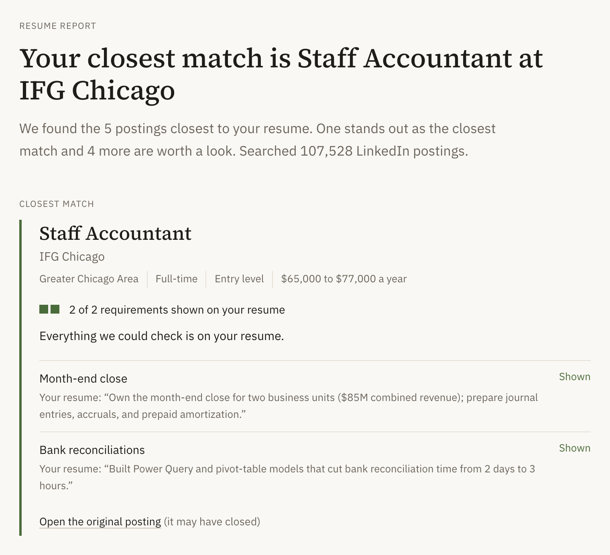
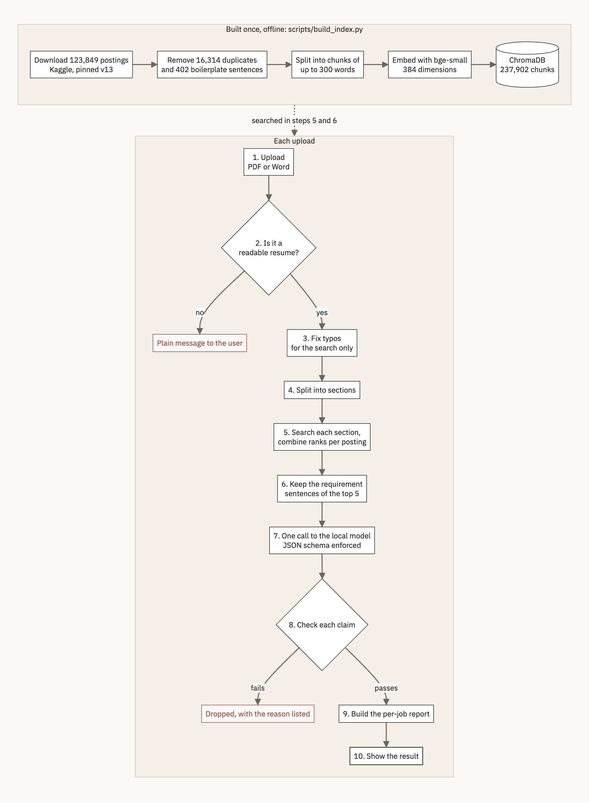
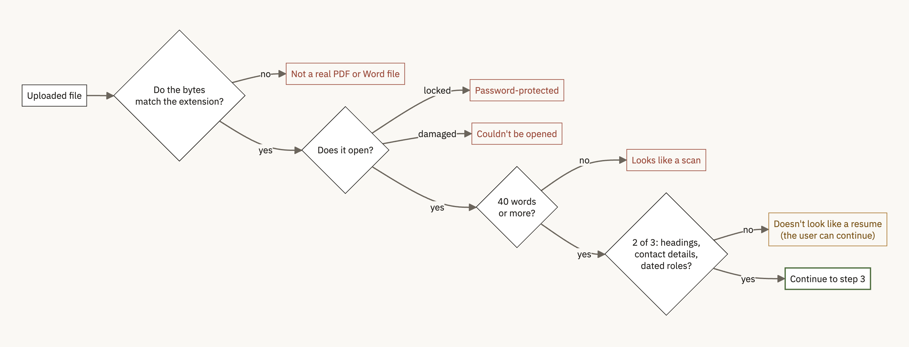
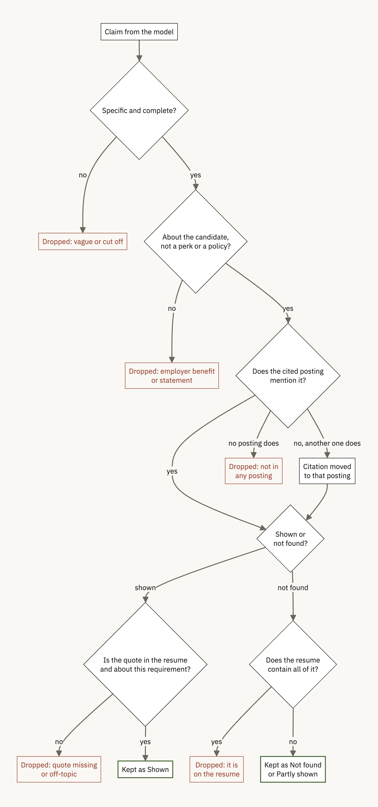
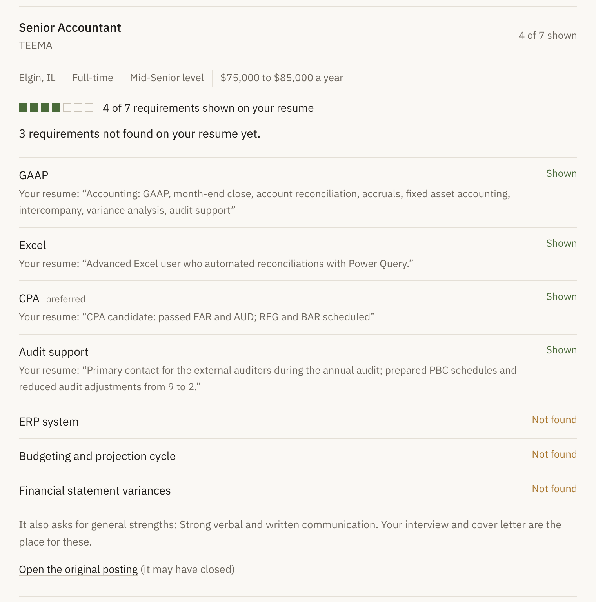
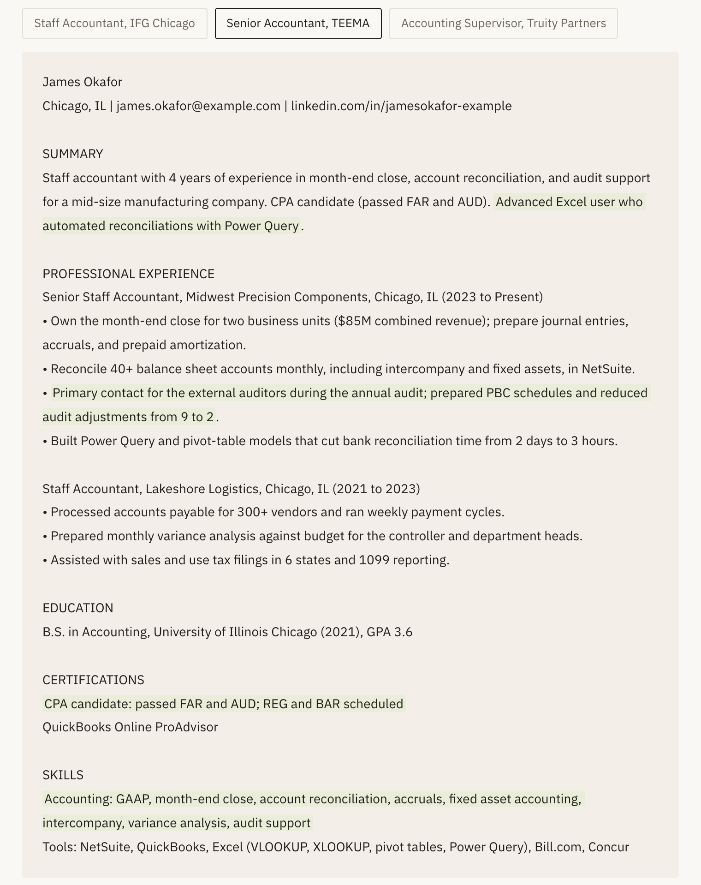

# ResumeMatch

ResumeMatch compares a resume with 107,528 real job postings. It finds the postings closest to
the resume, checks each of their requirements against what the resume says, and shows what is
there, what isn't, and what to work on before applying.

It is a retrieval-augmented generation (RAG) system that I built from scratch for CS6120
(Natural Language Processing) at Northeastern University in Fall 2026. A small language model
runs locally and proposes requirements. Python code then checks each one against the resume and
the posting it came from, and only the ones that pass are shown.



| | |
|---|---|
| Corpus | 123,849 LinkedIn postings, 107,528 after removing duplicates, split into 237,902 chunks |
| Model | `llama3.2:3b` through Ollama, on the same machine. No paid API, and the resume never leaves the computer |
| Speed | About 20 seconds per resume on an M3 Pro laptop. The search itself takes 0.04 seconds |
| Interfaces | A Streamlit app (required for the course) and a Next.js site, both using the same Python code |
| Tests | 152 unit tests. Each design change was measured first, and the results are in the [engineering log](docs/engineering-log.md) |

## Contents

1. [Overview](#overview)
2. [From upload to result](#from-upload-to-result)
3. [Building the index](#building-the-index)
4. [What the checks rule out](#what-the-checks-rule-out)
5. [Results so far](#results-so-far)
6. [Running it](#running-it)
7. [Project layout](#project-layout)
8. [Dataset and license](#dataset-and-license)

## Overview

The resume is the search query, and the job postings are the documents being searched. The
postings are indexed once, ahead of time. After that, each uploaded resume goes through the ten
steps in the lower half of the diagram.



The model is small enough to run on a laptop, which keeps the project free and private, but it
makes mistakes a reader would notice: it misquotes the resume, cites the wrong posting, and lists
employee benefits as skills. So the model never decides anything on its own. It proposes, and
the code checks. Rankings and verdicts are computed in code from things that can be verified.

## From upload to result

Each step lists the files that implement it.

### 1. Upload

The user drops a PDF or Word file on the page. The browser checks the file extension first, and
the server checks it again. The server also turns away empty files and anything over 5 MB, and it
runs one analysis at a time. If a second resume arrives while one is being checked, that person
is told to try again in a minute. A local model on one GPU slows down for everyone when it
serves two requests at once, so a clear message is better than a hidden queue.

Files: `web/app/page.tsx`, `src/resumematch/api/app.py`, `src/resumematch/frontend/streamlit_app.py`

### 2. Check that the file is a readable resume

This happens before any model is loaded. The file goes through four checks, and the first one
that fails decides what the user is told.



My first idea was to accept anything that looked similar to job postings. When I measured it,
that idea failed in exactly the cases that matter. A cover letter scored 0.710 and a job posting
scored 0.806, both higher than every real resume I tested (0.556 to 0.687). They are written in
the same language as the postings. What does separate them is structure: resumes have section
headings, contact details and dates for each role, and those documents don't. The last check
shows a warning with a "Check it anyway" button instead of blocking, because an unusually
formatted resume could miss the signals, and blocking a real person's resume would be worse than
letting them continue.

Files: `src/resumematch/ingest/validate.py`, `src/resumematch/ingest/parse_resume.py`

### 3. Fix typos for the search

Words that never appear in the corpus are corrected by edit distance against a 159,808-word
vocabulary built from all the postings. This is the autocorrect from Assignment 3, with rules
added after it made real mistakes. Words shorter than four letters, acronyms and mixed-case words
are left alone. Two-letter edits are only allowed on words of eight letters or more.
Capitalized words in the middle of a line are often names, so they only get one-letter fixes.
That rule came from the corrector turning the company name "Midstate" into "Mistake".

The corrected text is used only for the search. The model and the checks read the resume as the
person wrote it, and every change is listed on the results page. With 10% of the words damaged,
correction raised the overlap with the clean search results from 0.60 to 0.86 up to 0.94 to 1.00,
and it made no false corrections on four clean resumes.

File: `src/resumematch/preprocess/query_correction.py`

### 4. Split the resume into sections

The resume is split at its headings: common names like Experience and Skills, lines in capitals,
and short capitalized lines that contain a heading word, such as "Work History". Pieces under 12
words are merged into the next section, and any section over 480 tokens is divided evenly at line
breaks. A resume without headings is split into even windows instead.

The reason is a limit of the embedding model: it reads 512 tokens and silently ignores the rest.
When I embedded a 1,015-token test resume as a single query, the search saw only the first half,
and the experience and skills sections were never used. There was no error. Searching section by
section covers the whole resume, and it lets the page show which part of the resume matched each
posting.

File: `src/resumematch/preprocess/resume_sections.py`

### 5. Search and combine the results

Each section is embedded with `bge-small-en-v1.5` and retrieves its 30 closest chunks from
ChromaDB. The section results are combined per posting with reciprocal rank fusion. A posting
gets 1 / (60 + its rank) from each section and the scores are added up, so a posting that several
sections agree on ranks above one that a single section likes. At most two postings per company
are kept, so one employer's near-identical listings can't fill the results, and the top five go
on to the next step.

Files: `src/resumematch/retrieval/embedder.py`, `vector_store.py`, `fusion.py`

### 6. Keep the requirement sentences

The search returns the best-matching chunk of each posting, but a requirement can be in any part
of it, so the remaining chunks are fetched too. Sentences about the employer, such as benefits,
mission statements and "we offer", are removed. Sentences that state requirements ("must",
"required", "preferred", "years of experience", "degree") are kept first, and each posting is
trimmed to about 260 words so that all five fit in one prompt.

File: `requirement_excerpt` in `src/resumematch/generation/job_report.py`

### 7. Ask the local model

The five postings and the resume go to `llama3.2:3b` in one prompt. The postings come first,
numbered, and the resume comes last between two markers, so the model can tell which text
describes the candidate. The model returns up to 12 requirements the resume meets and 12 it
doesn't. Each one names the posting it came from, and each match includes a quote from the
resume.

The output format is enforced with a JSON schema, so the answer always parses and the model
can't cite a posting number outside 1 to 5. The temperature is 0.2. The context window is set to
8,192 tokens because Ollama's default of 4,096 was 96% full on a real prompt, and anything beyond
the limit is cut without warning. If an answer still can't be used, the model is asked once more.

I first tried one call per posting. It took 60 to 68 seconds and the results included company
slogans like "Best Place to Work". One call for all five postings takes 16 to 21 seconds, and
because each claim already names its posting, the claims can be sorted into per-posting lists
afterwards. Asking the model to take requirements from every posting doubled the number of
postings with results on two of the three test resumes.

Files: `src/resumematch/generation/gap_analysis.py`, `ollama_client.py`

### 8. Check each claim

Every claim from the model goes through the checks below. A claim that fails is dropped from the
results and listed, with the reason, under "How this was checked".



The comparisons ignore case, punctuation and line breaks, treat plurals as the same word, and
use a short list of equivalent terms, so "advanced cardiac life support" matches "ACLS" and
"critical care" matches "intensive care unit". Text the model wrote is cleaned of long dashes and
emoji. Quotes from the resume and the postings are always shown exactly as written.

Each of these checks comes from a mistake I saw in testing. The model quoted posting text as if
it were the resume, matched "Java" to a posting that never mentions Java, said a resume was
missing AWS when it listed AWS, and suggested "403(b) retirement plan" and "Child care" as skills
to learn. I tried fixing the benefits by telling the model not to list them, and measured it:
real findings dropped from 2.8 to 0.2 per run, and the benefits kept appearing. Filtering them in
code works.

Files: `check_claims` in `src/resumematch/generation/gap_analysis.py`, `text_clean.py`

### 9. Build the report for each posting

The checked claims are grouped by posting. For each requirement the report records:

- its status: shown (with the quote from the resume), partly shown (the resume has at least two
  of its key words, which are listed), or not found on the resume
- whether the posting says it is required or preferred, read from the part of the sentence that
  mentions it, so "BLS required; ACLS preferred" gives each one the right label
- whether it is a credential, like a degree or a license, which can't be added by rewording a
  resume
- whether it is a general trait like "clinical judgment". These are listed separately and not
  counted, since no line of a resume can confirm or rule them out

The postings are then sorted into three groups:

| Group | Rule |
|---|---|
| Closest match | The highest-ranked posting from the search that doesn't ask for a missing required credential |
| Also worth a look | The other postings without a missing required credential |
| Not a match right now | Asks for a required degree or license that isn't on the resume. The card names it |

Missing requirements that come up in several postings are combined ("Cardiogenic shock" and
"Cardiogenic shock experience" count once) and listed under "What to work on", most frequent
first. If nothing at all could be confirmed, the page says it couldn't connect the document to
the job requirements, and no posting is presented as the closest match.

I started with a score based on the share of requirements met, and it labelled an RN ICU posting
"not a match" (1 of 9) for a nurse with six years in intensive care. The model had listed very
specific items such as "experience in renal failure", which a resume rarely names word for word.
A word check can confirm that something is on a resume, but it can't prove that something is
missing, so the share of matches wasn't a fair measure. The groups now come from the search
ranking plus the credential check.

File: `src/resumematch/generation/job_report.py`

### 10. Show the result

Both interfaces show the same report, and all the wording comes from the Python code, so they
always match. The page has:

- the closest match, with location, work type, seniority and pay when the posting lists them,
  the requirement list with resume quotes, and a link to the original posting
- the other postings as rows that open into the same list
- "What to work on" across all five postings
- the resume, with the evidence for the selected posting highlighted (the positions are worked
  out in Python, so both interfaces highlight the same text)
- "How this was checked": the resume sections searched, the postings found and which sections
  found them, every typo fix, and every claim that was dropped, with the reason

The uploaded file is deleted as soon as the check finishes.

Files: `src/resumematch/frontend/render.py` and `streamlit_app.py`, `src/resumematch/api/app.py`,
`web/components/Report.tsx`





## Building the index

`scripts/build_index.py` builds the index once. The full corpus takes about 40 minutes on a
laptop.

1. Download the dataset with `kagglehub`, pinned to version 13. The file layout changed between
   versions once, which broke an unpinned download.
2. Skip exact duplicates: 16,314 postings whose description had already appeared.
3. Remove boilerplate. A sentence is boilerplate if it appears in at least 20 postings from at
   least 10 companies, or if it matches legal wording such as equal opportunity statements,
   unless it states a requirement like a degree or a lifting limit. This found 402 sentences and
   lowered the share of chunks with equal opportunity text from 26.9% to 2.9%.
4. Split each posting into chunks of whole sentences, up to 300 words each, with about 50 words
   of overlap. 68.4% of chunks now end at the end of a sentence, up from 25.9%. Short skill lists
   are joined to the description.
5. Embed each chunk and store it in ChromaDB with the job ID, title, company and posting URL, so
   every result can be linked to its source without another lookup.
6. Write the supporting files to `data/processed/`: the typo vocabulary, the boilerplate list,
   and the posting details used on the result cards. A `BUILD_COMPLETE.json` file is written
   last, so an interrupted build is never mistaken for a finished one.

## What the checks rule out

- A requirement is only marked as shown when the resume contains a quote that mentions it.
- Every requirement listed under a posting is one that posting asks for.
- Employee benefits, company descriptions, legal statements and half-finished phrases are never
  listed as requirements.
- A posting is only called "not a match" when it requires a degree or license that isn't on the
  resume. Gaps are described as "not found on your resume".
- A file that isn't a readable resume gets an explanation before any model runs.

The checks compare wording. If a resume describes a skill in different words, the requirement can
still show as not found. The page says this, and the reader decides.

## Results so far

The methods, numbers and the scripts behind them are in the
[engineering log](docs/engineering-log.md), including the ideas that didn't work.

| Measure | Result |
|---|---|
| Share of the resume the search uses | 100%, up from 50% for a 1,015-token resume searched as one query |
| Search results with 10% of words misspelled, without and with correction | 0.60 to 0.86 and 0.94 to 1.00 overlap with the clean results |
| Wrong corrections on clean resumes | 0, across four resumes from four fields |
| Chunks containing legal boilerplate | 2.9%, down from 26.9% |
| Model answers that parse on the first try | 100% with the JSON schema |
| Time per resume (M3 Pro, Ollama on the GPU) | 16 to 21 seconds, of which the search is 0.04 |
| Wrong files: renamed, damaged, locked, scanned, not a resume | Each gets its own message. All four test resumes pass |

Known limits: the model finds only a few requirements for some postings, and the results change
somewhat between runs. The word checks miss equivalent terms that aren't in the list (a resume
that says NetSuite is shown as missing "ERP system"). The search can't tell a pediatric posting
from an adult one. So far the testing uses synthetic resumes, and real PDFs with unusual layouts
still need to be tried.

## Running it

### Setup

```bash
cp .env.example .env   # add KAGGLE_USERNAME and KAGGLE_KEY from Kaggle > Settings > API
python -m venv .venv
.venv/bin/pip install -r requirements.txt && .venv/bin/pip install -e .
```

### Build the index (once)

```bash
.venv/bin/python scripts/build_index.py              # full corpus, about 40 minutes
.venv/bin/python scripts/build_index.py --limit 2000 # small index for development
```

An index built before the posting details existed can get them in a few seconds:

```bash
.venv/bin/python scripts/build_posting_details.py
```

### Start the model

```bash
brew install ollama && brew services start ollama   # macOS, runs on the Metal GPU
ollama pull llama3.2:3b
```

### Streamlit app

```bash
.venv/bin/streamlit run src/resumematch/frontend/streamlit_app.py
# open http://localhost:8501
```

### Next.js site

The site needs two processes: the Python API, and the web server, which passes `/api` requests
to it.

```bash
.venv/bin/uvicorn resumematch.api.app:app --host 127.0.0.1 --port 8000
```

```bash
cd web && npm install && npm run dev
# open http://localhost:3100
```

Set `API_URL` if the API runs somewhere else (the default is `http://127.0.0.1:8000`). The API
has `GET /api/health` and `POST /api/analyze` (a multipart `file`, plus optional `correction` and
`allow_unusual` fields). Errors come back as `{"detail": {"code", "message", "soft"}}`, and the
interactive API docs are at `http://127.0.0.1:8000/api/docs`.

### Docker (Streamlit app)

```bash
# App in Docker, model in Ollama on the Mac's GPU: about 11 seconds per resume
OLLAMA_HOST_FOR_APP=http://host.docker.internal:11434 docker compose -f docker-compose.local.yml up

# Everything in Docker, CPU only on a Mac: about 37 seconds per resume
docker compose -f docker-compose.local.yml up --build
```

When the container starts, it waits for Ollama, downloads the model if needed, and reuses
`./chroma_db` and `./data/processed` if they hold a complete index. Otherwise it builds one. Both
folders are mounted from the host, so the index is only built once. Compose reads the Kaggle
credentials from `.env`, which is never copied into the image. Docker covers the Streamlit app
for now. The API and the Next.js site run as shown above.

### GCP (course demo on a GPU)

```bash
source .env
./gcp/start.sh
# On the VM: install the NVIDIA container toolkit and Docker Compose, clone this repository, and
# copy over the index built locally instead of rebuilding it on paid GPU time:
#   gcloud compute scp --recurse chroma_db data/processed <vm-name>:~/resumematch/ --zone=<zone>
docker compose -f docker-compose.gcp.yml up --build -d
./gcp/stop.sh   # run this every time; the $50 credit is the whole budget
```

### Tests and evaluation

```bash
.venv/bin/python -m pytest -q        # 152 tests; no model or index needed
.venv/bin/python scripts/eval_query_correction.py RESUME.pdf [MORE.docx ...]
.venv/bin/python scripts/eval_resume_coverage.py RESUME.pdf [--swap nursing|software]
```

Synthetic resumes from three fields (nursing, accounting and mechanical engineering) are in
`eval/resumes/`. The people in them are fictional.

## Project layout

```
src/resumematch/
  ingest/        parse_resume.py, validate.py (upload checks), job_postings_loader.py
  preprocess/    chunker.py, boilerplate.py, resume_sections.py, query_correction.py
  retrieval/     embedder.py, vector_store.py, fusion.py (reciprocal rank fusion)
  generation/    ollama_client.py, gap_analysis.py (prompt, schema, claim checks),
                 job_report.py (report per posting), text_clean.py
  frontend/      streamlit_app.py, render.py (HTML for the results page)
  api/           app.py (JSON API for the Next.js site)
  pipeline.py    runs steps 2 to 9 for one resume
web/             Next.js site: app/, components/, lib/
scripts/         build_index.py, build_posting_details.py, eval_*.py, wait_for_ollama.py
tests/           unit tests for each module
eval/resumes/    synthetic resumes used in testing
docs/            design.md, engineering-log.md, diagrams/ (diagram sources), images/
gcp/             start.sh and stop.sh, to keep GPU costs within the credit
data/            raw/ and processed/ (not in git)
```

The diagrams are drawn from the Mermaid files in `docs/diagrams/`. After editing one, render it
again to `docs/images/` with any Mermaid renderer.

## Privacy

Resumes are processed on the machine running ResumeMatch and deleted when each check finishes.
Nothing is stored, and nothing is sent to an outside service.

## Dataset and license

LinkedIn Job Postings (2023 to 2024), collected by
[ArshKA](https://github.com/ArshKA/LinkedIn-Job-Scraper), with 100,000 more postings added by
`zoeyyuzou`. [Kaggle dataset](https://www.kaggle.com/datasets/arshkon/linkedin-job-postings),
licensed under [CC BY-SA 4.0](https://creativecommons.org/licenses/by-sa/4.0/). Any processed
version of this data shared from this project stays under the same license.
