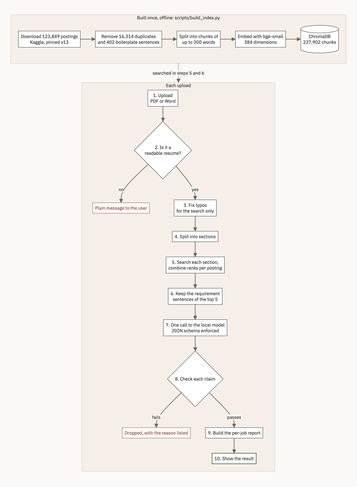
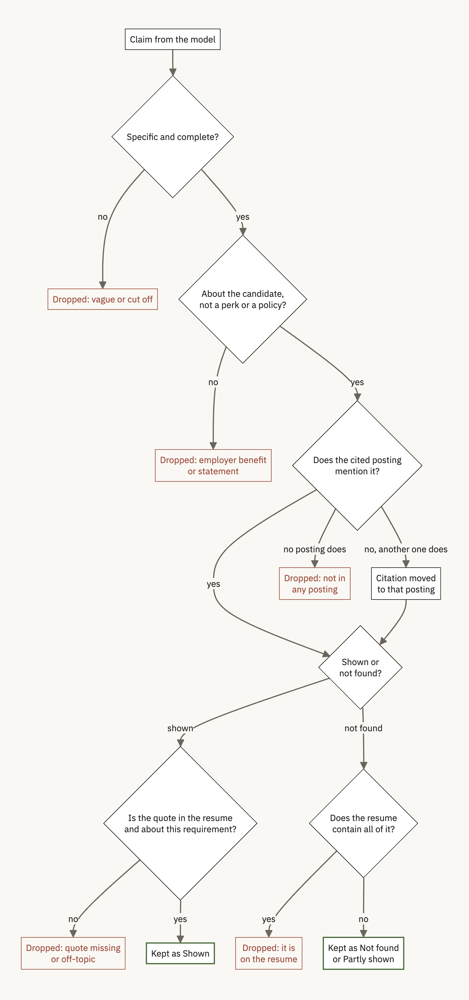

# Design

This document describes the system as it is now: what each part does, why it was built that
way, what has been verified, and where every number comes from. The history of how each
decision was reached, including the ideas that failed, is in
[engineering-log.md](engineering-log.md).

## What it does

ResumeMatch takes a resume (PDF or Word), finds the five closest job postings among 107,528
LinkedIn postings, and reports which of their requirements the resume shows, which it doesn't,
and what comes up across postings. A local language model proposes requirements; code checks
every one against the resume and the posting it cites before it is shown.

The resume is the query and the postings are the indexed documents. That gives a large, real
corpus to search and a citation for every claim, since each posting has a `job_posting_url`.

## Architecture

### Offline: building the index

`scripts/build_index.py`, run once (about 40 minutes for the full corpus on an M3 Pro).

| Step | What happens | Module |
|---|---|---|
| Download | `kagglehub`, dataset pinned to version 13 | `ingest/job_postings_loader.py` |
| Clean | Skip 7 postings with no description and 16,314 exact duplicates (normalized description hash) | `ingest/job_postings_loader.py` |
| Boilerplate | A sentence in at least 20 postings from at least 10 companies, or matching legal wording, is removed unless it states a requirement. 402 sentences found | `preprocess/boilerplate.py` |
| Chunk | Whole sentences packed into chunks of up to 300 words, about 50 words of overlap; short skills lists folded into the description | `preprocess/chunker.py` |
| Embed and store | `BAAI/bge-small-en-v1.5` (384 dimensions) into ChromaDB with job ID, title, company and URL | `retrieval/embedder.py`, `retrieval/vector_store.py` |
| Side files | Typo vocabulary (159,808 words), boilerplate list, posting details; `BUILD_COMPLETE.json` written last | `scripts/build_index.py` |

### Per upload

| Step | What happens | Module |
|---|---|---|
| 1. Upload | Extension check in the browser and on the server; 5 MB limit; one analysis at a time | `api/app.py`, `frontend/streamlit_app.py`, `web/app/page.tsx` |
| 2. Validate | Bytes match the extension; file opens; at least 40 words; at least 2 of 3 resume signals (headings, contact details, dated roles). The last check is a warning the user can override | `ingest/validate.py` |
| 3. Typo correction | Edit distance against the corpus vocabulary, with guard rails; used for the search only | `preprocess/query_correction.py` |
| 4. Sections | Split at headings, at most 480 tokens per section, fragments under 12 words merged | `preprocess/resume_sections.py` |
| 5. Search | 30 nearest chunks per section, reciprocal rank fusion per posting (k = 60), at most 2 postings per company, top 5 | `retrieval/fusion.py` |
| 6. Excerpts | All chunks of each posting, employer sentences removed, requirement sentences first, about 260 words each | `generation/job_report.py` |
| 7. Generate | One call to `llama3.2:3b`; JSON schema enforced (up to 12 matched and 12 not found, citation bounded to 1 to 5); temperature 0.2; context 8,192 tokens; one retry | `generation/gap_analysis.py`, `generation/ollama_client.py` |
| 8. Check | Each claim checked against the cited posting and the resume (see below) | `generation/gap_analysis.py` |
| 9. Report | Claims grouped by posting; status, importance, credential and soft-skill flags; tiers; "what to work on" | `generation/job_report.py` |
| 10. Show | Same report in both interfaces; uploaded file deleted | `frontend/render.py`, `api/app.py`, `web/components/Report.tsx` |

### The claim checks

A claim is dropped, with the reason recorded, if it is vague or cut off, describes an employer
benefit or policy, is not mentioned by any retrieved posting, or (for a match) quotes text that
is not in the resume or doesn't mention the requirement. A gap is dropped if the resume
contains all of its key terms. If the cited posting doesn't mention a requirement but another
retrieved posting does, the citation is moved. Comparisons ignore case, punctuation and line
breaks, fold plurals, and use a short synonym list (for example "advanced cardiac life support"
and "ACLS").

## Decisions

| Choice | Alternative tried | Measured reason | Source |
|---|---|---|---|
| Search the resume as sections of at most 480 tokens | Whole resume as one query | One query saw 510 of 1,015 tokens (50%); sections see all of it | Log, [resume-truncation](engineering-log.md#resume-truncation) |
| Reciprocal rank fusion, k = 60 | None | Standard value with no tuning; combines rankings without calibrating distances. Not compared against alternatives yet | Log appendix, "searched as several queries" |
| HNSW search_ef 200, construction_ef 200 | ChromaDB defaults (search_ef 10) | Recall@30 against exact search 0.972 vs 0.791 over 91 sections, repeatable across processes, same query time | Log, [search-recall](engineering-log.md#search-recall) |
| `llama3.2:3b` | `llama3.1:8b` | With the JSON schema, 3B averaged 12 s and 8B 29 s per resume; 8B justified claims with irrelevant quotes. One resume, M3 Pro | Log appendix, "Generating the gap analysis" |
| JSON-schema constrained decoding | Text format with a format reminder and retry | Text: 7 of 8 usable, 4 of 8 on the first try, 32 s average. Schema: 8 of 8 on the first try, 12 s. One resume | Log, [json-constrained-decoding](engineering-log.md#json-constrained-decoding) |
| At most 2 postings per company | No cap | Without it one staffing agency took 6 of the test resume's top 10; with it, 2 | Log appendix, "Chunking job postings" |
| One pooled model call | One call per posting | Per posting: 60 to 68 s with company slogans as requirements. Pooled: 16 to 21 s. Two resumes | Log, [per-job-calls](engineering-log.md#per-job-calls) |
| Tiers from retrieval rank plus a credential gate | Share of requirements met | The share rule called an RN ICU posting "not a match" (1 of 9) for an ICU nurse | Log, [ratio-tiers](engineering-log.md#ratio-tiers) |
| Upload check on structure | Similarity to postings | A cover letter (0.710) and a job posting (0.806) scored above every real resume (0.556 to 0.687) | Log, [resume-check](engineering-log.md#resume-check) |
| Benefits filtered in code | A prompt instruction | The instruction cut verified gaps from 2.8 to 0.2 per run and didn't reduce benefit claims | Log, [benefits-prompt-ab](engineering-log.md#benefits-prompt-ab) |
| ChromaDB | FAISS | FAISS has no persistence or metadata storage; at this scale its speed advantage doesn't matter. Not benchmarked | Log appendix, "Why ChromaDB" |
| No RAG framework | LangChain, LlamaIndex | A design choice, not a measurement: each step is plain Python so it can be read and tested | Log appendix |

## Configuration

`config.yaml` holds the tunable values: chunking (300 words, 50 overlap), retrieval (top 5
postings, 30 chunks per section, 2 per company), typo-correction guard rails (minimum word
length 4, two-letter edits from 8 letters), generation (temperature 0.2, 1,024 output tokens,
8,192 context) and the report call (12 items per list, coverage line on, 1,536 output tokens).
`.env` holds machine-specific values: the Ollama address and model, the embedding model, the
index path and the Kaggle credentials.

## Interfaces

Two front ends render the same report. Streamlit (`frontend/streamlit_app.py`) is the quick
local interface: one process, no build step. The Next.js site (`web/`) is the polished,
public-facing one; it calls a FastAPI service (`api/app.py`) that wraps the same pipeline.
All text a user reads is produced in Python, and highlight positions in the resume are computed
in Python and sent to the page, so both interfaces always match.

## Deployment

- **Laptop:** the app runs natively or in Docker; Ollama runs natively to use the Metal GPU.
- **Docker:** `docker-compose.local.yml` waits for Ollama, pulls the model if needed, reuses a
  complete index from the mounted `chroma_db/` and `data/processed/`, and otherwise builds one.
  Docker covers the Streamlit app; the API and the Next.js site run outside it.
- **Sample index:** `scripts/make_sample_index.py` builds a 2,000-posting index with contact details
  removed, plus CC BY-SA 4.0 license and attribution files; it is published as a release asset and
  installed by `scripts/fetch_sample_index.py`, which verifies its SHA-256.
- **GPU VM:** `docker-compose.gcp.yml` and `gcp/start.sh` create a GCP VM with a T4 GPU, about
  $0.50 to $0.55 an hour, or over $350 a month if left running. The index is built locally and
  copied up so the VM only pays for inference. `gcp/stop.sh` stops it.

## Verified and not verified

| What | Result | Hardware | Sample | Date | Source |
|---|---|---|---|---|---|
| Unit tests | 213 pass, no model, index or network needed | M3 Pro, macOS | Whole suite | 2026-11-09 | `pytest -q` |
| Parsing and sections on synthetic resumes | All 36 fixture files (17 resumes, PDF and Word) parse into 3 or more sections; DOCX tables and a two-column PDF handled | M3 Pro | 17 resumes | 2026-11-09 | `tests/test_resume_fixtures.py`, log entries 21 and 22 |
| Grounding of shown claims | 0 of 91 shown claims failed a check; 26 of 184 proposed claims dropped as not in any retrieved posting | M3 Pro | 4 resumes, 2 runs each | 2026-11-09 | Log, [grounding-audit](engineering-log.md#grounding-audit) |
| Full index build | 107,528 postings, 237,902 chunks, about 40 min | M3 Pro (CPU) | Full corpus | 2026-11-08 | `data/processed/build_full.log` |
| Search and fusion | 0.08 to 0.23 s per resume (median per resume) | M3 Pro | 3 resumes, 3 runs each | 2026-11-09 | Log, [benchmark](engineering-log.md#benchmark) |
| End-to-end, current pipeline, native | 13.8 s median (11.4 to 19.4 s), Ollama on the Metal GPU | M3 Pro, 18 GB | 3 resumes, 9 runs | 2026-11-09 | Log, [benchmark](engineering-log.md#benchmark) |
| End-to-end, current pipeline, Docker on CPU | 57.0 s median (35.5 to 72.3 s), measured before the summary was removed | Docker Desktop on the M3 Pro, 11 CPUs, 8 GB | 3 resumes, 6 runs | 2026-11-09 | Log, [benchmark](engineering-log.md#benchmark) |
| Small index build | 87 s for 2,000 postings with the dataset already downloaded; 66 MB on disk, 36 MB compressed | M3 Pro | One build | 2026-11-09 | Log, [benchmark](engineering-log.md#benchmark) |
| Search recall against exact search | 0.972 mean recall@30 after tuning (0.791 with defaults); identical results across processes | M3 Pro | 17 resumes, 91 sections | 2026-11-09 | Log, [search-recall](engineering-log.md#search-recall) |
| End-to-end, earlier pipeline (superseded) | 11 s native Metal; 37 s warm and 69 s cold fully in Docker on CPU | M3 Pro | One resume | 2026-11-08 | Log appendix, "Deployment" |
| Upload validation | 4 resumes pass; renamed, damaged, locked, scanned and non-resume files each get their own message | M3 Pro, both interfaces | 9 files | 2026-11-09 | Log, [resume-check](engineering-log.md#resume-check) |
| Both interfaces end to end | Report renders; checklists, highlights, rejected claims shown | M3 Pro, Chrome | Accountant and nurse resumes | 2026-11-09 | Manual browser check |
| Docker with the current code | **Partly verified.** The image was rebuilt and the pipeline ran inside it (the benchmark above). The Streamlit app in the container and the new entrypoint step were not run | | | | |
| GPU VM profile | **Not run** | | | | |
| CPU-only host | **Not measured** | | | | |
| Real resumes, scanned or image-heavy PDFs | **Not tested.** All 20 resumes are synthetic; one two-column PDF and one DOCX table are covered | | | | |
| Retrieval quality against labels | **Not measured.** No relevance labels exist yet | | | | |
| Claim-check precision against labels | **Not measured.** "Correct on inspection" in the log is my reading, not an independent label set | | | | |
| Sample index | 37.3 MB; fetched with checksum check and run through the full pipeline on 2 resumes | M3 Pro | 2 resumes | 2026-11-10 | Log, [sample-index](engineering-log.md#sample-index) |
| Fresh-clone quick start | **Not run end to end.** Each step ran separately; the release asset is not published yet | | | | |

## Numbers and their sources

| Number | Value | Source |
|---|---|---|
| Rows in `postings.csv` | 123,849 | Measured 2026-11-09 from the CSV |
| Postings with no description | 7 | Measured 2026-11-09 |
| Exact duplicates skipped | 16,314 | Measured 2026-11-09; `build_full.log` |
| Postings indexed | 107,528 | `build_full.log`, `chroma_db/BUILD_COMPLETE.json` |
| Chunks | 237,902 | `build_full.log`, `chroma_db/BUILD_COMPLETE.json` |
| Boilerplate sentences | 402 | `build_full.log` |
| Typo vocabulary | 159,808 words | `build_full.log` |
| Chunks with equal opportunity text | 26.9% before, 2.9% after (full index) | Log appendix, "Full-scale results" |
| Chunks ending at a sentence boundary | 25.9% before, 68.4% after (full index) | Log appendix, "Full-scale results" |
| Search coverage of a 1,015-token resume | 50% as one query, 100% as sections | Log, [resume-truncation](engineering-log.md#resume-truncation) |
| Typo overlap at 10%, software resume | 0.82 without correction, 0.98 with (5 seeds) | Re-run twice on the tuned index, 2026-11-09, identical; the earlier 0.76 and 0.80 came from the untuned index ([search-recall](engineering-log.md#search-recall)) |
| Typo overlap at 10%, four resumes | 0.68 to 0.82 without correction, 0.92 to 0.98 with | Tuned index, 2026-11-09 (earlier values on the untuned index: 0.60 to 0.86 and 0.94 to 1.00) |
| Unsupported "matched" claims before the checks | 35 of 48 (73%) | Log appendix, "Generating the gap analysis": 6 runs, one resume, `llama3.2:3b` |
| Constrained decoding | 8 of 8 usable on the first try | Log, [json-constrained-decoding](engineering-log.md#json-constrained-decoding) |
| Ollama memory with `llama3.2:3b` | about 3.4 GB | Log appendix, "Deployment" |
| Dataset download | 531 MB (`postings.csv` 517 MB) | Measured 2026-11-09 |
| Search recall against exact search | mean 0.972 (0.791 with ChromaDB defaults) | Log, [search-recall](engineering-log.md#search-recall) |

## Open issues

- Word checks miss equivalent terms outside the synonym list; a resume listing NetSuite shows
  "ERP system" as not found. They fail toward "not found", never toward a false match.
- The model finds only a few requirements for some postings, and results vary between runs.
- Search alone doesn't tell a pediatric posting from an adult one.
- Rank fusion lets several agreeing sections outvote one: a career changer's results follow
  their experience more than a new skills section
  ([skills-swap-outvoted](engineering-log.md#skills-swap-outvoted)).
- The vector search is approximate: 97% recall on average after tuning, with a few sections near
  70% ([search-recall](engineering-log.md#search-recall)).
